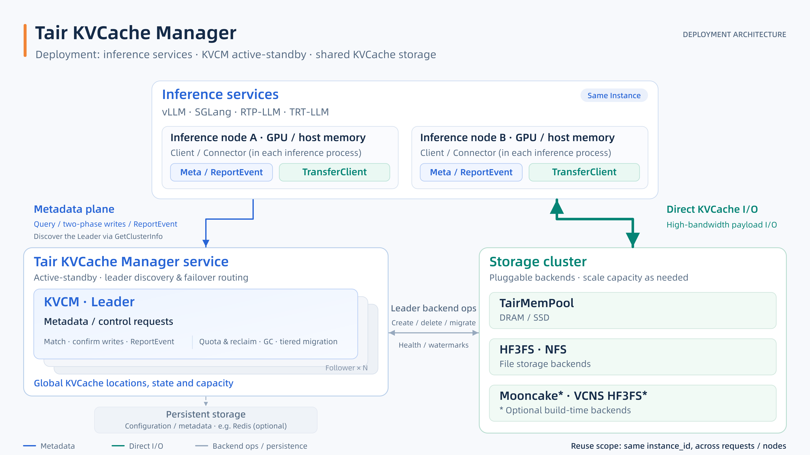
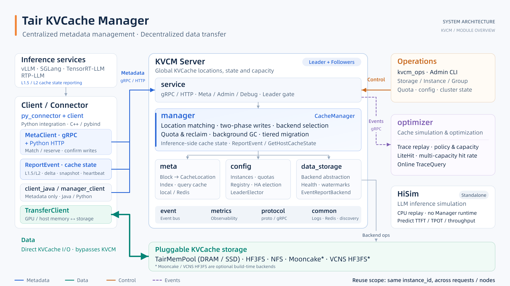
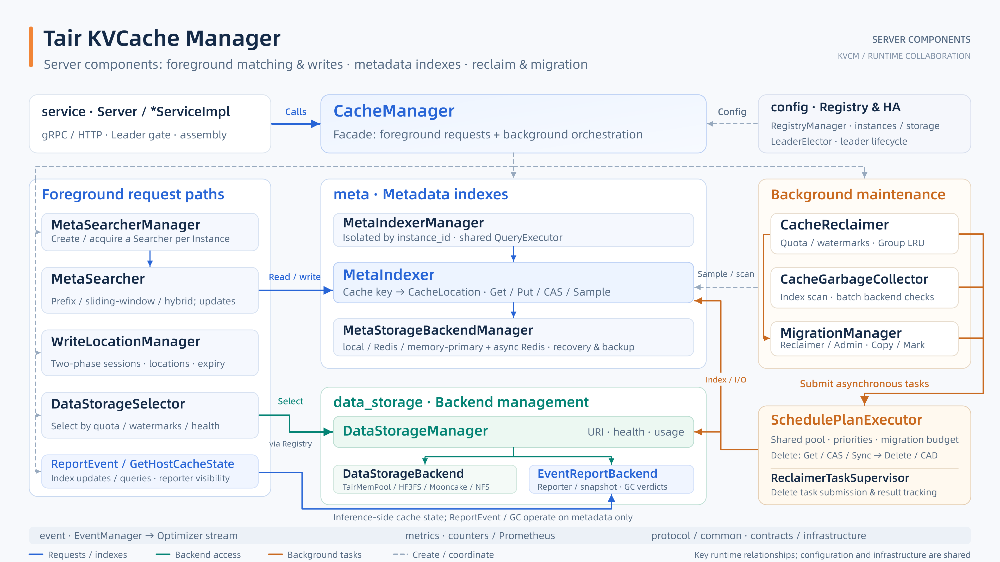

# Tair KVCache

--------------------------------------------------------------------------------

 
    |<a href="https://github.com/alibaba/tair-kvcache/blob/main/README_zh.md"><b>中文版本</b></a>|

--------------------------------------------------------------------------------

[Tair KVCache](https://www.aliyun.com/product/kvcache) is Alibaba Cloud's high-performance KVCache system designed for Large Language Model (LLM) inference scenarios. Through technologies such as distributed memory pooling and dynamic multi-level caching, it achieves acceleration and efficiency improvement while reducing resource costs.
Currently, the global KVCache management system Tair KVCache Manager and the LLM inference simulation system Tair KVCache HiSim have been open-sourced.

## Tair KVCache Manager

Tair KVCache Manager (KVCM) is a global KVCache metadata management service for LLM inference. It separates KVCache location, state, and capacity management from individual inference instances, enabling engines to reuse KVCache across requests and nodes within the same instance—reducing recomputation, lowering inference cost, and improving time-to-first-token (TTFT) and throughput.

### Key capabilities

- **LLM-aware matching**: prefix matching, reverse rolling sliding-window matching, hybrid attention (Mamba/SWA), and batch queries by block key, with multi-LocationSpec organization for hybrid attention.
- **Two-phase writes**: reserve a write location, write the data, then confirm; only confirmed blocks become readable.
- **Multi-tenant quotas and fair reclaim**: Instance Group quotas, backend watermarks, Group LRU / usage-proportional policies, asynchronous eviction that does not block foreground requests.
- **Tiered storage**: DRAM/SSD hot-cold tiers, watermark-triggered background Copy or Mark writes, expanding effective cache capacity while controlling the hot tier.
- **Inference-side cache state reporting**: inference services use ReportEvent incremental updates + optional snapshots to bring L1.5/L2 cache state into the global index; GetHostCacheState evaluates host-local and global hits.
- **Enterprise HA**: active-standby deployment, Redis/File/Memory-based leader election, automatic failover, and client-side leader discovery.
- **Observability and operations**: Prometheus/KMonitor metrics, access logs, RequestContext tracing, crash stack decoding, and the kvcm_ops CLI.
- **Optimization loop**: offline trace replay for eviction and capacity planning, LiteHit for fast multi-capacity hit-rate projection, and an online optimizer that replays KVCM events in real time.

### System Architecture

KVCM follows a "centralized metadata management + decentralized data transfer" design:

- **Metadata plane**: inference engines query or reserve KVCache locations through the Client/Connector. KVCM answers "where the data is and whether it is readable"; it does not carry KVCache payloads.
- **Data plane**: engines use the returned storage URIs to read/write KVCache directly through the transfer layer, so the metadata service does not become a bandwidth bottleneck.
- **Control plane**: operators use AdminService to manage storages, instance groups, instances, quotas, migration, configuration snapshots, and cluster state.

#### Deployment view

#### Module view

> This is a simplified, presentation-oriented module view. The engineering version with full dependency directions, intentional reverse edges, and runtime flows is in [Module Architecture](docs/design/module_architecture.md).

#### Server component relationships

The following view expands the main server components: foreground queries and writes, metadata indexes, storage backends, and the reclaim, GC, migration, and shared executor paths. Inference services call ReportEvent through the Client/Connector to report L1.5/L2 cache state. This API updates metadata and reporter state without transferring KVCache payloads.

### Modules

The main components, in one sentence each:

**Access and orchestration**
- **service**: receives gRPC/HTTP requests from inference engines, checks whether this node is the leader, then hands off to `CacheManager`.
- **CacheManager**: the system orchestrator; dispatches requests to matching, write, reclaim, and migration components and coordinates background tasks.

**Foreground requests**
- **MetaSearcher**: finds cache—matches reusable KVCache locations from the index based on the request's tokens/blocks.
- **WriteLocationManager**: write-session management—records the locations and timeout for a two-phase write so the confirmation step can find them.
- **DataStorageSelector**: picks storage—chooses the storage backend for a write based on quota, watermarks, and health.
- **ReportEvent / GetHostCacheState**: inference-side cache state—accepts L1.5/L2 cache reports and answers host-level hit queries; metadata only.

**Metadata and storage**
- **MetaIndexer**: the cache directory—maps each block to its `CacheLocation` and supports query, write, conditional update, and sampling.
- **DataStorageManager**: manages storage backends—connections, health, and capacity for TairMemPool, HF3FS, Mooncake, NFS, etc.

**Background maintenance**
- **CacheReclaimer / CacheGarbageCollector / MigrationManager**: handle capacity reclaim, stale-metadata cleanup, and hot/cold tier migration in the background, all asynchronously and off the foreground path.

**Configuration, infrastructure, and ecosystem**
- **RegistryManager / LeaderElector**: store instance, quota, and storage configs and handle active-standby election and failover.
- **event / metrics / protocol / common**: provide the event bus, metrics, protocol contracts, logging, Redis, request context, and other shared infrastructure.
- **client / py_connector / client_java / manager_client**: connect inference engines to KVCM for metadata queries and KVCache data transfer; choose the client that fits the engine and language.
- **optimizer / HiSim / kvcm_ops**: optimizer replays traces for policy and capacity planning, HiSim simulates inference on CPU, and kvcm_ops manages storage, instance groups, and cluster state.

### How a read/write works

1. **Read**: the engine asks KVCM for the locations of matching KVCache, then loads the data directly through the data-plane `TransferClient`; KVCM never carries the payload.
2. **Write**: the engine reserves a write location, writes the data, and confirms completion; only confirmed blocks become visible to later reads.

For more details, see the [documentation index](docs/README.md).

If you want to learn more about the detailed design of Manager, refer to: [Alibaba Cloud Tair KVCache Manager: Architecture Design and Implementation of Enterprise-level Global KVCache Management Service](https://mp.weixin.qq.com/s/apZIaiI5zazumEYNQHTdHg)

**Tair KVCache Manager Client/Connector**

A unified transfer library supports KVCache transfer for multiple inference engines and storage backends. It currently supports vLLM, SGLang, RTP-LLM, and TRT-LLM, with C++, Python, and Java client options.

## Tair KVCache HiSim

[HiSim](hisim/README.md) is a high-performance CPU-based simulation system for LLM inference. It enables fast, low-cost, and high-fidelity prediction of key performance metrics (such as TTFT, TPOT, and throughput) across different models, target hardware, inference engines, and configurations—by replaying real-world inference workload traces without requiring actual GPU resources. Currently supports SGLang v0.5.6.post2 with Qwen3 Dense series models on H20 GPUs, achieving prediction errors below 5%.

# Contact Us
- If you have technical questions or feature requirements related to this project, feel free to submit issues.
- If you have commercial cloud service product consultation needs for KVCache, please refer to [Alibaba Cloud Tair KVCache Product Page](https://www.aliyun.com/product/kvcache) and [Alibaba Cloud Tair KVCache Product Documentation](https://help.aliyun.com/zh/redis/product-overview/tair-kvcache/) to contact us.
