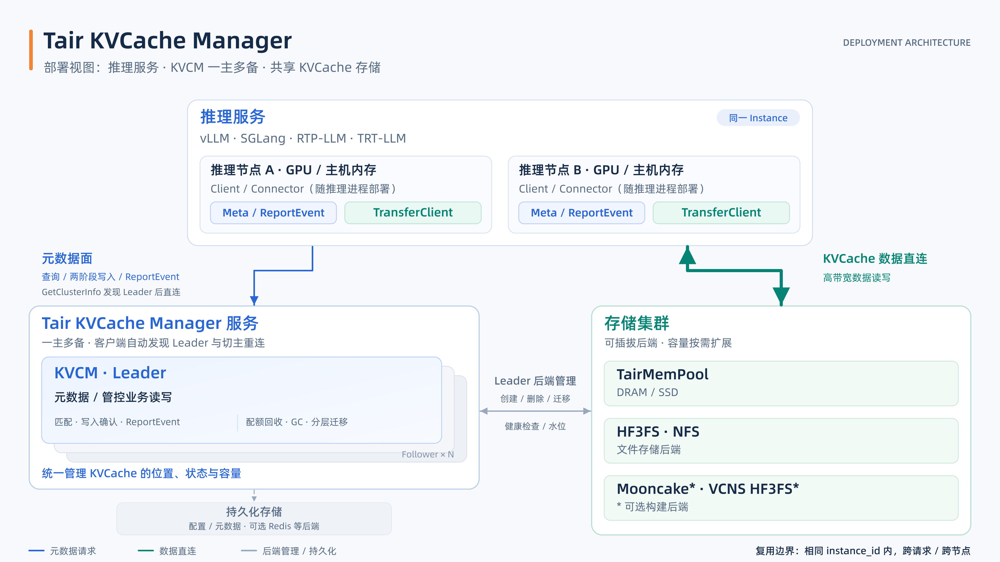
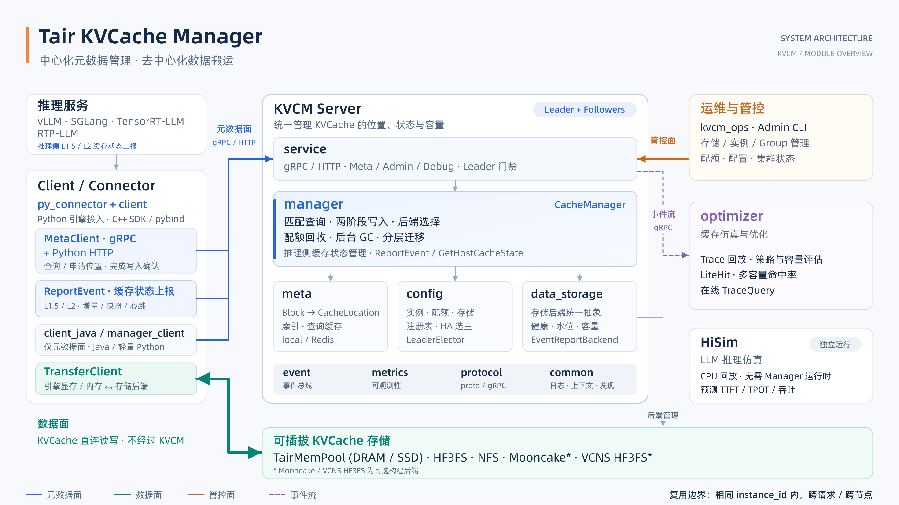
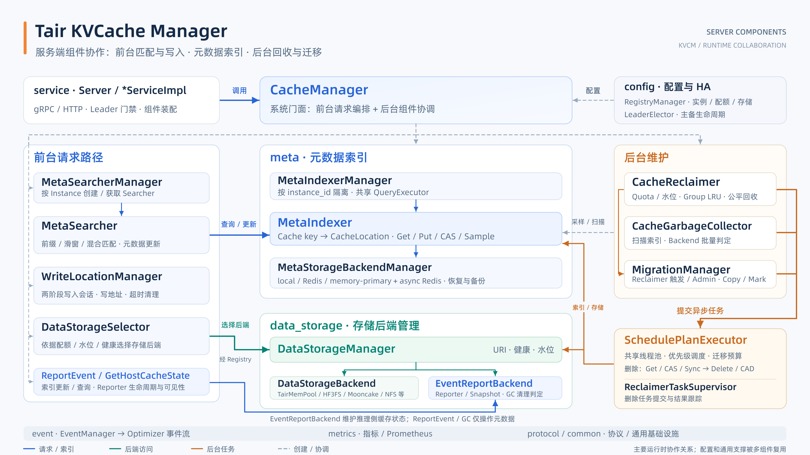

# Tair KVCache

--------------------------------------------------------------------------------

 
    |<a href="https://github.com/alibaba/tair-kvcache/blob/main/README.md"><b>English Version</b></a>|

--------------------------------------------------------------------------------

[Tair KVCache](https://www.aliyun.com/product/kvcache) 是阿里云为大语言模型（LLM）推理场景设计的高性能 KVCache 缓存系统，通过分布式内存池化、动态多级缓存等技术，实现加速提效的同时降低资源成本。
目前，其中的全局 KVCache 管理系统 Tair KVCache Manager 和 LLM 推理仿真系统 Tair KVCache HiSim 已经开源。

## Tair KVCache Manager

Tair KVCache Manager（KVCM）是面向大语言模型（LLM）推理的全局 KVCache 元数据管理服务。它把 KVCache 的位置、状态和容量从单个推理实例中抽离出来统一管理，使推理引擎可以在同一 Instance 内跨请求、跨节点复用 KVCache，减少重复计算，降低推理成本，并改善首 token 时延（TTFT）与吞吐表现。

### 核心能力

- **LLM 语义感知匹配**：支持前缀匹配、反向滚动滑动窗口匹配、混合注意力（Mamba/SWA）和按 block key 批量查询，以及混合注意力场景下的多 LocationSpec 组织。
- **两阶段写入**：先申请写地址，数据写完后确认，只有确认成功的 Block 才会进入可读状态，保证缓存可信。
- **多租户配额与公平回收**：以 Instance Group 为配额单位，结合后端水位、Group LRU、按用量比例等策略异步逐出，前台请求不被删除阻塞。
- **分层存储**：DRAM/SSD 等冷热分层，按水位触发后台 Copy 或 Mark 补写，在控制热层容量的同时扩大有效缓存。
- **推理侧缓存状态纳管**：推理服务通过 ReportEvent 增量上报 + 可选 Snapshot 对账，把 L1.5/L2 缓存状态纳入全局索引；GetHostCacheState 支持主机级本地/全局命中评估。
- **企业级高可用**：一主多备部署，基于 Redis/File/Memory 的分布式选主，故障自动切换，客户端自动发现 Leader。
- **可观测与可运维**：Prometheus/KMonitor 指标、访问日志、RequestContext 全链路追踪、崩溃栈解析、kvcm_ops 运维 CLI。
- **优化闭环**：离线 Trace 回放评估驱逐策略与容量配置，LiteHit 快速计算多容量命中率，在线 Optimizer 可通过 KVCM 事件流实时回放。

### 系统架构

KVCM 采用“中心化元数据管理 + 去中心化数据搬运”的设计：

- **元数据面**：推理引擎通过 Client/Connector 查询或申请 KVCache 的存储位置。KVCM 只回答“数据在哪、是否可读写”，不传输 KVCache 数据本身。
- **数据面**：引擎拿到存储位置 URI 后，通过传输层直接读写存储后端，避免元数据服务成为带宽瓶颈。
- **管控面**：运维工具通过 AdminService 管理 Storage、Instance Group、Instance、配额、迁移、配置快照和集群状态。

#### 部署视图

#### 模块视图

> 这是面向展示的简化模块图；包含完整依赖方向、反向边和运行时流程的工程版见 [模块架构与关联关系](docs/design/module_architecture.md)。

#### 服务端组件协作

下图展开服务端内部的主要组件，展示前台查询与写入、元数据索引、存储后端，以及回收、GC、迁移和共享执行器之间的协作。推理服务通过 Client/Connector 调用 ReportEvent 上报 L1.5/L2 缓存状态；该接口更新元数据及 Reporter 状态，不搬运 KVCache 数据。

### 模块介绍

按服务端组件协作图，主要组件可以这样理解：

**接入与编排**
- **service**：接收推理引擎的 gRPC/HTTP 请求，检查当前节点是不是 Leader，再把请求交给 `CacheManager`。
- **CacheManager**：系统总调度，把请求分给匹配、写入、回收、迁移等组件，并协调后台任务。

**前台请求**
- **MetaSearcher**：找缓存——根据请求的 token/block，在索引中匹配出可复用的 KVCache 位置。
- **WriteLocationManager**：写会话管理——记录本次写入分配到的位置和超时，写完确认时用它找回写入位置。
- **DataStorageSelector**：选存储——根据配额、后端可用性和偏好策略，决定这次写入放到哪个存储后端。
- **ReportEvent / GetHostCacheState**：推理侧缓存状态——接收 L1.5/L2 缓存上报，并提供主机级命中查询；只操作元数据。

**元数据与存储**
- **MetaIndexer**：缓存目录——记录每个 block 的 CacheLocation，支持查询、写入、条件更新和采样。
- **DataStorageManager**：存储后端管理——管理 TairMemPool、HF3FS、Mooncake、NFS 等后端的连接、健康和容量。

**后台维护**
- **CacheReclaimer / CacheGarbageCollector / MigrationManager**：后台维护——分别负责容量回收、失效元数据清理和冷热分层迁移，均异步执行，不阻塞前台。

**配置、通用支撑与生态**
- **RegistryManager / LeaderElector**：配置与 HA——保存实例、配额、存储等配置，并负责一主多备的选主与故障切换。
- **event / metrics / protocol / common**：通用支撑——事件总线、指标上报、协议定义，以及日志、Redis、上下文等基础设施。
- **client / py_connector / client_java / manager_client**：推理引擎接入层——负责元数据查询；其中 `client` / `py_connector` 还负责 KVCache 数据搬运，不同语言/框架按需选用。
- **optimizer / HiSim / kvcm_ops**：优化、仿真与运维——optimizer 用 trace 回放评估策略和容量，HiSim 用 CPU 仿真推理性能，kvcm_ops 管理 Storage、Instance Group 和集群状态。

### 一次读写如何工作

1. **读**：引擎向 KVCM 查询命中的 KVCache 位置，拿到 URI 后由数据面 `TransferClient` 直接加载数据；KVCM 不搬运数据。
2. **写**：引擎先申请写地址，数据写完后回调确认；只有确认成功的 Block 才会被后续读取命中。

如果想要了解更多 Manager 详细设计，可参考：[阿里云Tair KVCache Manager：企业级全局 KVCache 管理服务的架构设计与实现](https://mp.weixin.qq.com/s/apZIaiI5zazumEYNQHTdHg)

**Tair KVCache Manager Client/Connector**

使用统一的传输库支持多推理引擎和存储后端的 KVCache 传输。当前支持 vLLM、SGLang、RTP-LLM、TRT-LLM 等引擎，并提供 C++、Python、Java 多种客户端形态。

## Tair KVCache HiSim

[HiSim](hisim/README.md) 是一个高性能的基于CPU的LLM推理仿真系统。它能够在不依赖实际GPU资源的情况下，通过回放真实推理负载Trace，快速、低成本、高保真地预测不同模型、目标硬件、推理引擎和配置下的关键性能指标（如TTFT、TPOT、吞吐量等）。当前支持SGLang v0.5.6.post2，在H20 GPU上运行Qwen3 Dense系列模型，预测误差低于5%。

# 联系我们
- 如有本项目相关技术问题和功能需求，欢迎提交issue。
- 如有KVCache商业化云服务产品咨询需求，请参考[阿里云Tair KVCache产品页](https://www.aliyun.com/product/kvcache)和[阿里云Tair KVCache产品文档](https://help.aliyun.com/zh/redis/product-overview/tair-kvcache/)联系我们。
