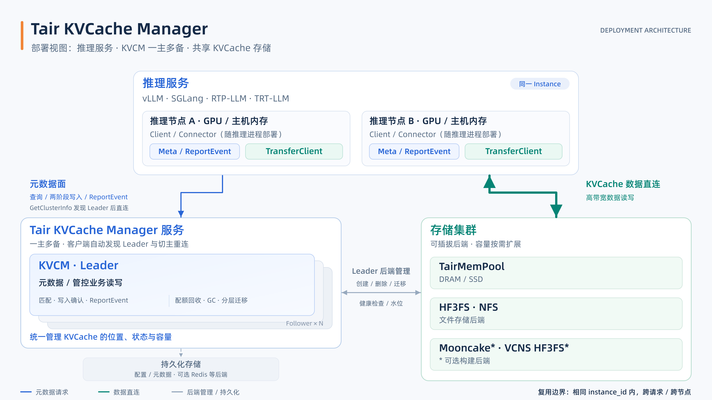

# 部署方式

## 部署架构



[中文 4K PNG](../image/kvcm-deployment-zh.png) · [中文 SVG](../image/kvcm-deployment-zh.svg) · [English PNG](../image/kvcm-deployment-en.png) · [English SVG](../image/kvcm-deployment-en.svg)

部署图突出推理服务、KVCM 主备与存储集群三个主体。Client/Connector 随各推理进程部署，先从任意 KVCM 节点通过 `GetClusterInfo` 发现 Leader，再直连 Leader 发送元数据请求。推理侧的 L1.5/L2 缓存状态通过 `ReportEvent` 上报；KVCache 数据通过 `TransferClient` 直连存储集群。

KVCM 以一主多备运行，Follower 提供发现、健康检查与运维监控，升主后恢复配置与索引，恢复完成且本轮租约仍有效时才开放业务。持久化存储作为配置与元数据的辅助依赖，可选 Redis 等后端；具体后端与参数见[配置指南](../configuration.md)，主备切换语义见[高可用与选主机制](../design/ha_leader_elector.md)。

## 启动 Manager
### 使用容器启动（推荐）
```
docker run kv_cache_manager_prod
```
- 如果需要修改参数，可以直接添加env ```docker run kv_cache_manager_prod --env xxxx=xxxx```
### 从源码启动
```
bazel run //kv_cache_manager:main
```
### 参数配置
可配置参数请参考文档：[configuration.md](../configuration.md)
- 默认参数：package/etc/default_server_config.conf
- 默认日志参数：package/etc/default_logger_config.conf
