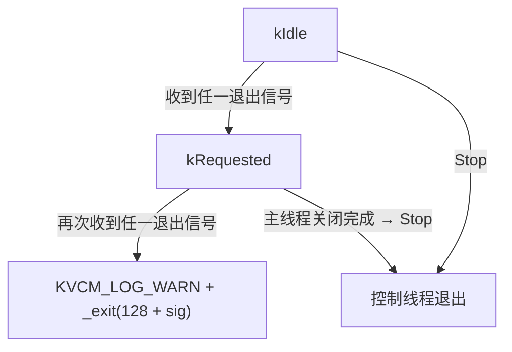

# 退出信号处理与优雅关闭设计

## 1. 概述

KVCM server 进程收到退出信号后需要完成一次可预期、可完成的优雅关闭：撤销选主资格、关闭业务门禁、排空已接受的请求、停止各服务端口、销毁服务与管理组件，最后以退出码 0 结束。Pod 漂移和发布依赖这个流程不丢已接受请求、不留脏的选主状态。

核心设计原则：**信号线程只通知，主线程是唯一执行者与唯一销毁者**。

- 退出信号在创建任何其它线程之前被全局阻塞，进程内不存在退出信号的 signal handler。
- 一个固定的控制线程用 `sigtimedwait` 在普通执行上下文（非信号处理器）里消费信号，只记录信号号并唤醒主线程，自身不执行任何组件的 Stop / join / 清理。
- 主线程被唤醒后按既有关闭顺序跑完整流程，并负责销毁所有对象。
- 优雅关闭进行中再次收到任一退出信号，视为运维要求强制结束，立即以 `128 + 信号号` 退出。

## 2. 背景：信号处理器里做关闭为什么不行

旧实现在 `__sign_handler__` 中处理退出信号：handler 抢全局锁、遍历 `CommandLine` 全局链表调用 `Terminate()` → `server_->Stop()`。这意味着整套关闭流程可能在内核选中的任意线程上执行——包括选主的 LeaderLock / LeaseCheck / 状态转换线程，以及正在处理业务请求的 gRPC 线程。由此产生三类只在特定信号落点复现的故障：

| 故障 | 成因 |
|---|---|
| `LoopThread::Stop()` 抛 `std::system_error` | 信号落在某个 LoopThread 的循环线程上，handler 在该线程里 join 该线程自己 |
| 重入死锁 | handler 在状态转换线程持有 `transition_mutex_` 时重入清理逻辑，再次获取同一把非递归锁 |
| 排空循环等待 | 门禁排空等待 in-flight 请求完成，而正在处理该请求的线程就是执行关闭的那个线程 |

此外，信号处理器上下文只允许调用 async-signal-safe 函数，而关闭流程需要加锁、打日志、调用 gRPC/HTTP 的 Shutdown，本身就不适合放在 handler 里。`Server::Stop()` 当时只用一个 `stop_` 布尔表示「已停就直接返回」，并发调用者不会等待第一次关闭完成，可能在组件 Stop / join 进行中并发进入。

## 3. 信号职责划分

| 信号 | 处置方式 | 说明 |
|---|---|---|
| SIGTERM / SIGINT / SIGUSR1 / SIGUSR2 | `ShutdownController` 阻塞掩码 + `sigtimedwait` | 四个信号语义一致，都是「请求优雅关闭」；无 handler |
| SIGPIPE | `signal(SIGPIPE, SIG_IGN)` | 保持忽略，对端断开不终止进程 |
| SIGSEGV / SIGABRT / SIGBUS / SIGFPE / SIGILL | `CrashHandler` | 崩溃信号不在阻塞集合内，崩溃路径不受影响，见 [崩溃堆栈打印](../crash-handler-zh_CN.md) |

退出信号集合与改造前完全相同，未新增也未移除。SIGUSR1 / SIGUSR2 是 POSIX 留给应用自定义语义的信号，KVCM 继续把它们定义为优雅退出；运维与集成测试实际只发 SIGTERM，SIGINT 只出现在客户端与压测工具中，SIGUSR1 / SIGUSR2 目前无调用方。若将来要把这两个信号复用为诊断用途（日志级别切换、dump 触发等），需单独立项。

## 4. 整体架构

```
                        kill -TERM <pid>（信号落到任意线程）
                                   │
                        全线程阻塞该信号 → 成为进程 pending
                                   │
      ┌────────────────────────────▼────────────────────────────┐
      │ ShutdownController 控制线程（普通执行上下文）              │
      │   sigtimedwait(100ms 轮询)                               │
      │   kIdle      → 记录信号号 + cv.notify_all + 继续循环       │
      │   kRequested → KVCM_LOG_WARN + _exit(128 + sig)          │
      └────────────────────────────┬────────────────────────────┘
                                   │ 只通知，不执行任何清理
      ┌────────────────────────────▼────────────────────────────┐
      │ 主线程 CommandLine::Run()                                │
      │   WaitForShutdownRequest() 返回                          │
      │   → Finish(): Server::Stop() / Wait() → server_.reset()  │
      │     → controller_.Stop() → DestroyLogger()               │
      └──────────────────────────────────────────────────────────┘
```

组件线程（选主、Metrics、gRPC/HTTP 业务线程）在任何情况下都不会成为关闭流程的执行者：信号被全局阻塞，它们既不会执行 handler，也不会被拉进关闭路径；即使收到定向信号，也只是自身 pending 队列上挂一个不会被取走的信号，继续执行自身逻辑。

### 4.1 方案取舍

| 方案 | 结论 | 理由 |
|---|---|---|
| 保留 signal handler，在 handler 里做关闭 | 否决 | 加锁 / 日志 / 组件 Shutdown 都不是 async-signal-safe；关闭执行者由内核随机选择，无法消除 self-join、重入与循环等待 |
| 控制线程直接执行完整 `Server::Stop()` | 否决 | 控制线程进入 Stop() 后不再 `sigwait`，关闭进行中收到的信号只能挂起到 Stop() 返回才被消费，「第二个信号强制退出」无法实现；要实现就得再加一个轮询看护线程，且主线程必须先 join 控制线程才能销毁 Server，多一处销毁时序耦合 |
| 控制线程只做最小唤醒（提前 `rpc_server_->Shutdown()`） | 否决 | 传输层会先于门禁关闭，新的 leader-only 请求拿到传输错误而不是门禁拒绝码，破坏客户端可见语义。这是 optimizer 服务现有范式不适用于 KVCM 主服务的原因 |
| `signalfd` / `epoll` 等待信号 | 否决 | Linux 专有，`sigtimedwait` 已足够且可移植 |
| **控制线程只通知 + 主线程执行**（采用） | ✅ | 主线程是固定的、非组件线程的执行上下文；控制线程始终在 `sigtimedwait` 上，重复信号能被立刻捕获 |

主线程不阻塞在 `rpc_server_->Wait()` 是可行的：gRPC 由自身线程池服务，`Wait()` 只是一道栅栏；启动失败路径原本也是先 `Stop()` 再 `Wait()` 这个顺序。

## 5. ShutdownController

`kv_cache_manager/common/shutdown_controller.{h,cc}`，与 `crash_handler`、`loop_thread` 同层，属进程级基础设施。

| 接口 | 语义 |
|---|---|
| `static bool BlockExitSignals()` | `pthread_sigmask(SIG_BLOCK, {SIGTERM,SIGINT,SIGUSR1,SIGUSR2})`；只设掩码，不启线程；**必须在创建任何其它线程之前调用** |
| `static const sigset_t &ExitSignalSet()` | 退出信号集合 |
| `bool Start()` | 启动控制线程；幂等；失败时解除阻塞掩码（fail-safe） |
| `bool WaitForShutdownRequest()` | 阻塞至收到退出信号或被 `Stop()` 打断；返回是否为信号驱动 |
| `void Stop()` | 置停止标志 + join；幂等；无信号时最多等待一个轮询周期 |
| `bool IsShutdownRequested()` | 是否已请求关闭 |
| `int ReceivedSignal()` | 首个退出信号号 |

### 5.1 状态机



`kIdle → kRequested` 时记录信号号、`cv_.notify_all()`，然后**继续循环**——这是「关闭进行中再来一个信号能立刻强退」的关键。强退分支在 `_exit()` 之前先释放互斥锁，与 `CrashHandler` 的 `_exit` 兜底一致：跳过 atexit 与静态析构，避免在关闭中途再触发一轮清理。

### 5.2 掩码继承与边界

- 掩码在 `daemon()`、logger 初始化（alog 会创建 flush 线程）、Server 启动之前设置，之后创建的线程一律继承，包括日志库、gRPC、HTTP、选主与 Metrics 线程。
- 控制线程进入循环时会对自己再 `pthread_sigmask(SIG_BLOCK)` 一遍：即使调用方漏掉 `BlockExitSignals()`，退出信号也不会在该线程触发默认终止动作，而是被 `sigtimedwait` 取走。
- `BlockExitSignals()` 只在 `CommandLine::Run()` 中调用，作用域限于 server 进程；客户端、压测工具与单元测试进程不受影响。
- 控制线程创建失败时解除阻塞掩码，恢复「SIGTERM 直接终止进程」的默认语义，避免进程变成只能被 SIGKILL 杀掉。
- `sigtimedwait` 的轮询周期（100ms）同时是 `Stop()` 的 join 延迟上限。
- `Stop()` 在互斥锁内更新停止标志：该标志是 `WaitForShutdownRequest()` 等待谓词的一部分，在锁外更新会让「谓词判假之后、进入等待之前」发出的 `notify_all` 丢失，等待者永久睡死。

### 5.3 测试约束

在同一进程内已经阻塞了退出信号、又希望用 `raise()` 让进程立刻终止的用例，必须先 `pthread_sigmask(SIG_UNBLOCK, &ExitSignalSet(), nullptr)` 再 `raise()`，否则信号只会挂起，用例会超时。信号屏蔽字还会跨 `exec` 继承，fork + exec 真实二进制的用例需要在子进程里先清空屏蔽字。

## 6. 启动与关闭时序

```
启动：Run() → ParseCmdLine → config.Parse
      → ShutdownController::BlockExitSignals()      ← 早于 daemon / logger / Server
      → StartDaemon → InitLogger / UpdateLogLevel / InitLogLevelFromEnv
      → InstallSignalPolicy()（CrashHandler::Install + SIGPIPE 忽略 + controller_.Start()）
      → 若已请求关闭则跳过 Server 启动，否则 new Server → Init → Start
      → controller_.WaitForShutdownRequest()        ← 主线程阻塞点

关闭：kill -TERM（落到任意线程，因全局阻塞而成为进程 pending）
      → 控制线程 sigtimedwait 返回 → kIdle→kRequested + cv.notify_all（继续循环）
      → 主线程 WaitForShutdownRequest() 返回
      → Finish():
          Server::Stop()（std::call_once）
            两个 redis 健康探测 RequestStop()（先让探测循环退出，稍后再 join）
            → leader_elector_->Stop()（撤销资格 → 关门禁 → 排空 → 清理 → 释放锁）
            → optimizer 订阅关闭 → gRPC Shutdown → HTTP Stop
            → role_state / metrics_report / redis_health / coordination_redis_health 四个 LoopThread 依次 Stop
          Server::Wait()（join HTTP 线程；gRPC Wait 立即返回）
          server_.reset()（销毁 service / manager，此时其依赖仍有效）
          controller_.Stop()（join 控制线程）
          LoggerBroker::DestroyLogger()
          return 0

强退：kRequested 状态下再次收到任一退出信号 → KVCM_LOG_WARN + _exit(128 + sig)
```

`Finish()` 是唯一的退出路径，正常关闭、启动失败、启动阶段就收到信号三条分支都经过它，因此关闭顺序只有一份实现。

### 6.1 顺序不变量

| 不变量 | 原因 |
|---|---|
| 门禁先于传输层关闭 | 新的 leader-only 请求要拿到门禁拒绝码而不是传输错误 |
| `leader_elector_->Stop()` 在组件关闭最前 | 生命周期回调需要 service 门禁与 manager 仍然存活 |
| `server_.reset()` 早于 `controller_.Stop()` | `server_.reset()` 里的析构会 join 各后台线程，是关闭流程中最可能阻塞的一段；控制线程活到它之后，「再收一个退出信号就强退」的兜底才覆盖得到这段，否则运维只能 SIGKILL |
| `controller_.Stop()` 早于 `DestroyLogger()` | 控制线程在强制退出路径上还要打 WARN 日志 |
| `Server::Stop()` 只执行一次完整关闭 | `std::call_once`：重复或并发的关闭请求（信号路径与启动失败路径同时触发）由其余调用者等待该次关闭完成后返回，不产生并发的组件 Stop / join |

`Server::Stop()` 内部的组件关闭顺序与日志文案不属于本次改造范围（含 redis 健康探测的 `RequestStop()` 与四个 LoopThread 停止点），变的只是「谁来调用」与「只完整执行一次」。`Server::Wait()` / `Server::OnNoLongerLeader()` 同样未改动。

### 6.2 边界情况

- **启动阶段收到信号**：掩码生效前收到的信号保持 pending，`controller_.Start()` 之后立刻被消费；`Run()` 在启动 Server 之前检查 `IsShutdownRequested()`，已请求则跳过 Server 启动直接进入关闭并返回 0，避免在已请求退出时还跑一遍冗长的 recovery。
- **信号落在组件线程上**：因全线程阻塞，信号不会在组件线程内被处理，只成为进程 pending 由控制线程消费。组件线程的阻塞系统调用可能被 `EINTR` 打断，各组件沿用现有错误处理，未引入 `SA_RESTART` 语义变化。
- **一个进程一个 `CommandLine`**：全局链表删除后不再支持多实例，与 `main.cpp` 的现状一致。

## 7. 可观测性

`LoopThread::Stop()` 在检测到「被自身循环线程调用」时置可观测标志 `self_join_detected_`（只读 accessor `SelfJoinDetected()`）并打 ERROR 日志，随后**照常 `join()`**——不跳过 join、不 detach。线上行为与改造前一致，问题在测试与日志中暴露而不是被掩盖；跳过 join 会让未完成的清理被静默吞掉，正是本次改造要消除的隐患类型。

关键日志与退出码：

| 观测点 | 内容 |
|---|---|
| 优雅关闭开始 | `server stopping...` |
| 关闭顺序 | `rpc server stopped.` → `meta http server stopped.` → `metrics reporter stopped.` → `admin http server stopped.` → `kvcm server stopped, goodbye!` |
| 强制退出 | `received exit signal <sig> again while shutting down, force exit with code <128+sig>`，且**没有** `goodbye` |
| 自连接 | `LoopThread[<name>] Stop() called from its own loop thread, self-join detected` |
| 退出码 | `0` 优雅关闭完成；`128 + 信号号` 强制退出；`-1` 启动失败 |

运维排查时可用 `/proc/<pid>/status` 核验掩码：`SigBlk` 应为 `0x4a02`（恰为 SIGTERM/SIGINT/SIGUSR1/SIGUSR2），`SigIgn` 含 SIGPIPE，`SigCgt` 只含 CrashHandler 的五个崩溃信号。控制线程停在 `sigtimedwait` 上时，内核对它的 `/proc` 掩码呈现为 0，属已知呈现方式而非掩码丢失。

## 8. 测试覆盖

| 场景 | 验证的约束 | 用例位置 |
|---|---|---|
| 掩码设置后新建线程 | 继承阻塞掩码，退出信号不在业务线程执行 handler | `common/test/shutdown_controller_test.cc` `NewThreadsInheritBlockedExitSignals` |
| 四个退出信号的处置 | 均为 `SIG_DFL`，进程内无 handler 残留 | 同上 `NoExitSignalHandlerIsInstalled` |
| 信号定向投递到工作线程 | 工作线程不进入关闭路径、不中断自身逻辑 | 同上 `SignalDirectedAtWorkerThreadDoesNotEnterShutdownPath` |
| 关闭进行中重复信号 | 子进程退出码 == `128 + sig`（四个信号逐一 fork 验证） | 同上 `RepeatedExitSignalForcesImmediateExit` |
| `Start` / `Stop` 幂等、等待与唤醒 | 重复调用安全；`Stop()` 在有界时间内返回；有信号则唤醒、无信号则继续阻塞 | 同上 `StartAndStopAreIdempotent` / `WaitForShutdownRequestWakesUpOnSignal` / `WaitForShutdownRequestBlocksWithoutSignal` |
| 信号落在 LeaderLock / LeaseCheck / 状态转换线程 | 关闭在有界时间内完成，无 `std::system_error`，所有 LoopThread 未检测到自连接 | `config/test/leader_elector_shutdown_test.cc` `DirectedSignalOnElectorThreadsDoesNotMakeThemRunShutdown` |
| 关闭时门禁回调正持有 `transition_mutex_` / 恢复进行中 / 降级清理进行中 | 三种 barrier 时序下关闭仍能完成且不跳过清理 | 同上 `ShutdownWaitsForLeadershipLostHandlerHoldingTransitionMutex` / `ShutdownWaitsForRecoveryInProgress` / `ShutdownWaitsForDemotionCleanupInProgress` |
| 请求线程持有 in-flight leader-only 请求时被定向投递信号 | 主线程先关门禁（新请求拿拒绝码而不是传输错误），再等请求完成后排空 | `service/test/service_impl_base_test.cc` `SignalledRequestThreadDoesNotDeadlockGateClosingAndDrain` |
| 在自身 loop 回调里调用 `Stop()` | 标志置真、抛 `std::system_error`；从其它线程调用时标志为假 | `common/test/loop_thread_test.cc` `TestStopFromOwnLoopThreadDetectsSelfJoin` / `TestStopFromOtherThreadDoesNotDetectSelfJoin` |
| 真实二进制收到单次 SIGTERM | 退出码 0，关闭日志序列完整且只出现一份 | `service/test/command_line_shutdown_test.cc` `SingleSigtermShutsDownGracefullyWithExitCodeZero` |
| 真实二进制在关闭进行中再收一个退出信号 | 退出码为 `128 + sig`，日志含 `force exit`，不含 `goodbye` | 同上 `SecondExitSignalDuringShutdownForcesImmediateExit` |
| 集成测试停服务 | 优雅关闭卡住时 60s 超时后 SIGKILL 并返回失败，不再无限轮询挂死 CI | `integration_test/client_test/service_process_controller.h` `StopService()` |

所有等待都有超时上限，无裸 `wait()` 与 sleep 掩盖。

### 8.1 e2e 重复信号用例的确定性做法

memory backend 的测试 server 优雅关闭只需约 1.2ms，用「轮询日志文件直到看见关闭开始」作为「第二个信号落在关闭进行中」的同步点，在并行负载下会退化成竞态（父进程读到开始日志时子进程往往已打完 `goodbye`）。标准信号不排队，同一编号的第二个 SIGTERM 会与第一个合并，也无法用来构造这个窗口。因此用例改为：`SIGSTOP` 冻结子进程 → 一次性投递 SIGTERM 与 SIGUSR1 两个**不同编号**的退出信号（各有独立 pending 槽）→ `SIGCONT` 放行。控制线程必然背靠背消费两个信号，第二个必定落在 `kRequested` 上触发强退；退出码断言为集合 `{128+SIGTERM, 128+SIGUSR1}`（谁先被消费未指定），顺带覆盖「四个退出信号语义一致」。

## 9. 已知边界与待完善

- **没有优雅关闭超时配置项与看门狗线程**：本次只以「重复信号强制退出」作为兜底。若需要自动超时，应先明确超时后是强退还是继续等待，再单独立项。
- **并发调用 `Server::Stop()` 没有专门用例**：构造 `Server` 需要完整配置与协调后端，单测成本高；「其余调用者等待同一次关闭完成」由 `std::call_once` 保证，e2e 用例断言关闭日志序列只出现一份。
- **Metrics 线程没有单独的定向投递用例**：新设计下退出信号全进程阻塞，任何线程都不可能成为信号落点并执行 handler；该不变量由掩码继承用例与 `/proc/<pid>/status` 核验覆盖（Metrics 线程在掩码生效之后才创建，必然继承）。
- **`ForceExitSignal()` 实际不可观测**：写入后控制线程立即 `_exit()`，任何调用方都读不到该值，目前也无调用方。
- **`Start()` 与 `Stop()` 并发时存在理论窗口**：`Start()` 先置已启动标志再创建线程，若与 `Stop()` 并发，`Stop()` 可能在线程对象赋值前就返回，随后赋值的 joinable 线程无人 join，析构会 `std::terminate`。当前只有主线程串行调用 `Start()` / `Stop()`，不可触发；后续可把标志更新移到线程对象赋值之后。
- **`Server` 不再暴露可读的「已停止」标志**：`stop_` 布尔换成 `std::once_flag` 后，外部无法查询关闭是否已发生（这是有意的：可读标志会诱使调用方用「读标志 + 早退」代替等待）。需要判断 server 是否已停的测试改为观察关闭路径会停掉的 LoopThread，例如 `service/test/server_redis_health_metrics_test.cc` 读 `metrics_report_thread_->is_running_`。不要为了这类检查在 `Server` 上重新加布尔标志。
- **`Stop()` 最多引入一个轮询周期（100ms）的关闭延迟**：这是有意的取舍，用它换取控制线程始终停在 `sigtimedwait` 上、能立刻捕获重复信号。

## 10. 相关文件

```
kv_cache_manager/
├── common/
│   ├── shutdown_controller.h/cc        # 退出信号阻塞掩码 + 控制线程状态机
│   ├── loop_thread.h/cc                # 自连接检测（只暴露不掩盖）
│   └── crash_handler.h/cc              # 崩溃信号处理，与退出信号互不干涉
├── service/
│   ├── command_line.h/cc               # Run() 单一退出路径、InstallSignalPolicy()、Finish()
│   ├── server.h/cc                     # Stop() 幂等化（call_once + DoStop()）
│   └── service_impl_base.cc            # leader-only 请求排空等待
├── config/
│   └── leader_elector.cc               # 撤销资格 → 关门禁 → 停线程 → 释放锁 → join 状态转换线程
└── main.cpp                            # 返回 CommandLine::Run() 的退出码

integration_test/client_test/
├── service_process_controller.h        # StopService() 带超时上限
└── client_test_base.h                  # 接收 StopService() 的返回值
```
