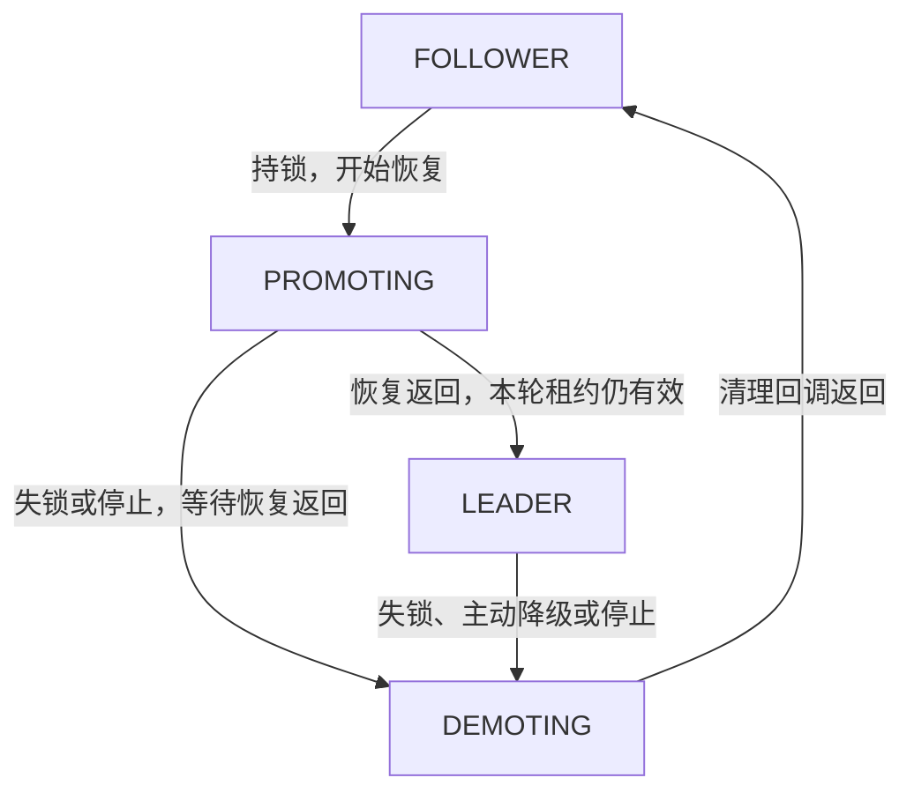

# 高可用与选主机制设计

## 1. 概述

KVCacheManager 支持多节点高可用（HA）部署模式。多个 KVCM 实例以一主多备的方式运行，通过分布式选主（Leader Election）选出唯一的 Leader 节点提供数据面服务，其余节点作为 Follower 待命。当 Leader 故障时，Follower 自动接管，实现故障自动转移。

核心设计目标：

- **自动选主**：无需人工干预，节点启动后自动参与选举。
- **故障转移**：Leader 故障或主动降级后，Follower 在租约过期窗口内自动接管。
- **Leader 发现**：客户端可向任意节点查询当前 Leader 地址，然后直连 Leader 进行数据面操作。
- **后端可扩展**：选主协调层支持多种后端（内存、文件、Redis），适配不同部署场景。

## 2. 整体架构

```
┌─────────────────────────────────────────────────────────────┐
│                      推理引擎 (Client)                        │
│                                                             │
│  ① GetClusterInfo → 发往任意节点 → 获取 leader_endpoint      │
│  ② 直连 Leader 进行读写（数据面 + 管控面）                     │
│  ③ 若请求被拒绝（Leader 已变更），回到 ① 重新发现               │
└──────────┬──────────────────────────────────┬───────────────┘
           │                                  │
  ┌────────▼────────┐               ┌────────▼─────────┐
  │ Node (Follower)  │               │  Node (Leader)    │
  │                  │               │                   │
  │  不处理读写请求    │               │   可以处理所有请求   │
  │  仅提供:          │               │                   │
  │  · Leader 查询   │               │                   │
  │  · 健康检查       │               │                   │
  │  · 运维监控       │               │                   │
  │                  │               │                   │
  │  LeaderElector   │               │  LeaderElector    │
  └────────┬─────────┘               └────────┬──────────┘
           │                                  │
  ┌────────▼──────────────────────────────────▼──────────┐
  │              CoordinationBackend                      │
  │           (分布式锁 + KV 存储)                         │
  │           实现: Memory / File / Redis                  │
  └───────────────────────────────────────────────────────┘
```

数据面和管控面的读写请求均由 Leader 处理。Follower 不处理业务请求，仅提供 Leader 查询（GetClusterInfo）、健康检查（CheckHealth）和运维监控（GetManagerClusterInfo）等能力。客户端收到 Follower 的拒绝后，应重新通过 GetClusterInfo 发现当前 Leader，将请求发往正确的节点。

## 3. 核心组件

### 3.1 CoordinationBackend

协调后端是选主和节点信息存储的基础设施层，提供两类原子操作：

- **分布式锁接口（选主用）：** TryLock / RenewLock / Unlock / GetLockHolder
- **KV 存储接口（节点端点信息存储用）：** SetValue / GetValue

三种实现：

| 实现 | URI 格式 | 适用场景 |
|---|---|---|
| CoordinationMemoryBackend | `memory://` | 单进程测试 |
| CoordinationFileBackend | `file:///path/to/dir` | 单机开发/测试 |
| CoordinationRedisBackend | `redis://[auth_token@]host:port/?db=<index>[&params]` | 生产环境 |

Redis DB 只能通过 query 参数 `db` 指定，未配置时使用 DB 0；URI path（例如 `/1`）不会选择 DB。`db > 0` 要求 Redis 服务端支持 `SELECT`，因此不适用于 Redis Cluster。

### 3.2 LeaderElector

LeaderElector 是选主状态机的核心实现，负责竞选、续约、降级和状态转换。

#### 3.2.1 角色状态机



| 状态 | 含义 | 是否参与竞选 | 业务门禁 |
|---|---|---|---|
| `FOLLOWER` | 尚未开始恢复，或已完成清理 | 未持锁、未停止、未在释放锁且冷却期结束时参与 | 关闭 |
| `PROMOTING` | 执行 OnBecomeLeader 回调 | 否；本轮有效时继续续约 | 仅恢复成功路径通过租约校验后开放 |
| `LEADER` | 恢复回调返回后的主节点角色 | 否；继续续约 | 取决于恢复成功路径是否开放；失锁时立即关闭 |
| `DEMOTING` | 执行 OnNoLongerLeader 回调 | 否 | 关闭 |

角色、是否持锁、业务是否可服务有不同含义。`IsLeader()` 保留原有“本地是否持锁”的查询语义；`GetLeaderNodeID()` 保留锁持有者发现语义。恢复期间发现自身为锁持有者，不代表业务门禁已经开放。

#### 3.2.2 线程模型与状态收敛

LeaderElector 保留 3 个线程：

| 线程 | 职责 | 周期 |
|---|---|---|
| LeaderLock | 仅在干净的 FOLLOWER 阶段竞选；持锁时续约 | `loop_interval_ms` |
| LeaseCheck | 独立检查本地租约，避免协调请求阻塞时继续服务 | `loop_interval_ms` |
| StateTransition | 根据当前锁状态串行执行恢复及清理，无历史任务队列 | 条件变量唤醒 |

锁变化只更新当前事实并通知处理线程，不逐次排入 promote/demote 任务。工作线程开始恢复时记录本地持锁轮次 `lock_epoch_`；每次获得或撤销租约都会推进轮次。恢复完成只能提交到同一轮有效租约，失锁事实不会因之后的通知被合并而消失。轮次仅用于本进程的生命周期与请求结果校验，不是存储层 fencing token。

持锁与角色不一致时处理线程继续收敛：FOLLOWER 持锁则开始恢复，LEADER 失锁则开始清理。恢复过程中失锁会先等待正在执行的回调返回，再直接执行清理，不经过可服务的 LEADER 状态。恢复尚未开始就失锁，无需执行恢复或清理。由此避免锁抖动造成任务积压以及遗漏必要的升主。

#### 3.2.3 失锁与业务门禁

确认失锁的条件为续约返回 `EC_NOENT` / `EC_MISMATCH`，或本地租约到期（保留提前一个循环间隔的检查余量）。普通续约错误在租约仍有效时只记录日志。

失锁处理在同一把状态互斥锁下撤销本地持锁状态、推进轮次，并通过 `SetLeadershipLostHandler` 同步关闭 Meta/Admin 业务入口。该快速回调只能关闭门禁，不得阻塞或重入 LeaderElector；请求排空、后台线程停止与清理留在 StateTransition 线程中执行。

恢复成功路径通过 `RunIfCurrentPromotionValid` 检查恢复轮次、本地租约及停止标记，再开放业务门禁。检查与开放入口使用失锁处理的同一把互斥锁，避免旧恢复在关闭入口后重新开放入口。此接口中的回调同样不得阻塞或重入。

Optimizer 的配置与订阅接口同时检查 `LEADER` 和 `IsStableState()`。本地失锁后，即使角色尚未进入 DEMOTING，也会拒绝新请求。恢复时启用订阅同样放在 `RunIfCurrentPromotionValid` 中；关闭已有订阅需要遍历并清理流，留在 `OnNoLongerLeader` 中执行。

失锁后的 PROMOTING、待清理的 LEADER 和 DEMOTING 都不参与竞选。只有清理回调返回、进入 FOLLOWER 后才允许再次竞选，并继续遵守现有 `forbid_campaign_time` 冷却配置。新一轮持锁重新执行恢复。

协调请求在发送前记录轮次，返回后重新校验。响应提交时必须在取得状态互斥锁之后读取当前时间，避免等待互斥锁期间租约已经过期，却按等待前的时间提交成功。迟到的抢锁结果或续约成功不能恢复已撤销的轮次，必要时按持有者校验释放锁。协调 I/O 不持有状态互斥锁，避免阻塞租约检查；主动释放锁期间也禁止新竞选。停止时先撤销业务资格，再停止选主/租约线程，处理线程完成已开始的恢复及必要清理后退出。

本次保留回调失败的现有行为：恢复提前返回或异常不新增失败重试、错误传播或角色转换阻断；清理返回错误或异常不新增重新竞选阻断。恢复成功路径之外不会因本次门禁调整而自动开放业务。

#### 3.2.4 节点端点信息

每个节点启动时将自身连接信息（node_id、host、各服务端口）写入 CoordinationBackend 的 KV 存储。任意节点获取到 leader_node_id 后，即可查询到 Leader 的完整连接方式，用于 Leader 发现。

#### 3.2.5 本次选主改造的评审入口

核心变化是用“当前租约事实 + 当前生命周期阶段”取代历史 promote/demote 任务队列。评审时先确认以下性质，再沿函数检查实现，最后对照 [场景测试覆盖](#75-状态收敛测试覆盖)。

- 判定失锁后同步关闭新业务入口；旧恢复不能再次开放入口。
- 已开始的恢复与清理由同一个工作线程串行执行；失锁后必须等这次清理返回才能重新竞选。
- 尚未开始恢复就失锁时，不执行无效恢复或清理；最终稳定持锁的 FOLLOWER 能启动一次必要恢复。
- 协调响应只能提交到发送时所属的有效轮次；取得状态锁后用当前时间检查租约，迟到成功不能恢复旧资格。
- 协调 I/O 和耗时生命周期回调不持有状态锁；必要的补偿释放不会删除其他节点或本节点下一轮的锁。

建议阅读顺序：

| 顺序 | 阅读位置 | Reviewer 要核对的行为 |
|---|---|---|
| 1 | `server.cc` 门禁接入；`LoseLeaseLocked` / `RunIfCurrentPromotionValid` | 关闭和开放门禁使用同一把状态锁；所有失锁入口都会撤销资格；快速回调只关闭/开放入口，不重入选主器 |
| 2 | `HasPendingTransitionLocked` / `ReconcileState` | 正常恢复、恢复失效后清理、LEADER 失锁后清理这三条路径完整；无历史任务积压；回调执行时已释放状态锁 |
| 3 | `CanCampaignLocked` / `DoDemote` | 失锁后的 PROMOTING、待清理 LEADER、DEMOTING 和主动释放锁期间均不能竞选；清理返回后仍遵守冷却期 |
| 4 | `CampaignLeader` / `AcceptLease` / `HoldLeader` / `ReleaseLock` | 发送前记录轮次，返回后重新检查轮次与期限；响应提交时读取时间的位置正确；拒绝结果后的释放先于本锁线程下一次竞选 |
| 5 | `StateTransitionWorker` / `Stop` / `IsStableStateLocked` | 条件变量等待当前事实；停止时在途响应不能提交，已开始的恢复与必要清理完成后才退出 |

重点交错时序及对应回归用例：

| 交错时序 | 重点检查 | 回归用例 |
|---|---|---|
| 恢复已开始 → 失锁 → 旧恢复返回 | 旧恢复不开放入口，先清理，再恢复竞选 | `LossDuringRecoveryBlocksCampaignThroughCleanupAndRecoversAgain` |
| 开放门禁与失锁同时发生 | 校验和开放不能在两个临界区；失锁处理返回后门禁关闭 | `GatePublicationAndLossAreSerialized` |
| 续约成功 → 等状态锁 → 租约到期 → 获得状态锁 | 不使用等待前的时间接受结果 | `RenewalWaitingForStateMutexCannotCommitExpiredLease` |
| 清理完成，但主动 Unlock 尚未返回 | 不允许新竞选与旧释放交错 | `CleanupCompletionDoesNotPermitCampaignBeforeUnlockReturns` |
| 续约响应阻塞 → 旧主失锁 → 新主持锁 → 旧响应返回 | 旧资格不复活，补偿释放保留新主的锁 | `LateRenewalReleaseDoesNotDeleteAnotherNodesLock` |
| Stop 与抢锁、恢复或清理同时发生 | 无在途结果提交；必要清理不被跳过 | `StopRejectsAcquisitionStillInFlight` / `StopWaitsForRecoveryCleanupAndNeverPublishesOldReadiness` / `StopDuringCleanupWaitsForAlreadyRunningCleanup` |

并发假设也属于评审范围：竞选和续约只有一个 LeaderLock 线程；恢复和清理只有一个 StateTransition 线程；回调在 Start 前注册；两个快速门禁回调不能阻塞或重入。`transition_mutex_` 保护角色变更、轮次和释放标记；同时访问锁持有者字符串时，按状态锁到持有者锁的顺序获取，不反向获取。

请求排空丢通知的修复在 `ServiceImplBase` 中独立核对：完成请求的计数递减取得 shared lock，排空等待取得同一把锁的 unique lock，保证谓词检查到进入等待之间不会丢掉最后一次完成通知。回调失败策略保留现状，本地轮次不提供存储层 fencing；这两项不是本次验收新增的保证。

## 4. Server 集成

### 4.1 初始化流程

Server 启动时通过 `CreateLeaderElector()` 完成 HA 初始化：

```
Server::Init()
  └─ CreateLeaderElector()
       ├─ 1. 解析 coordination_uri
       ├─ 2. 确定 host（advertised_host > NetUtil::GetLocalIp()）
       ├─ 3. 确定 node_id（配置指定 > 自动生成）
       ├─ 4. 创建 CoordinationBackend 并 Init
       ├─ 5. 创建 LeaderElector
       ├─ 6. 注册回调: OnBecomeLeader / OnNoLongerLeader / 快速关闭业务门禁
       └─ 7. WriteNodeInfo 将本节点端点信息写入 CoordinationBackend
```

### 4.2 角色变更回调

**OnBecomeLeader（晋升为 Leader）：**

1. Registry 数据恢复（从持久化存储加载配置）
2. 启动配置加载（首次启动时加载 startup_config）
3. CacheManager 数据恢复（重建缓存索引）
4. 恢复 CacheReclaimer（缓存回收线程）
5. 通过 RunIfCurrentPromotionValid 校验持锁轮次与租约后，启用业务请求

**OnNoLongerLeader（降级为 Follower）：**

1. 暂停 CacheReclaimer
2. 禁用数据面请求
3. 等待所有进行中的数据面请求完成（优雅关闭）
4. CacheManager 清理
5. Registry 清理

失锁时业务入口已经由快速回调关闭；OnNoLongerLeader 再次关闭入口并等待已有请求结束。最后一个业务请求的计数递减与排空等待使用同一把请求状态锁，避免通知发生在谓词检查与进入等待之间，造成计数已归零但清理线程仍等待。恢复与清理串行执行，清理回调返回后才恢复本节点竞选。Server::Stop 在服务与管理组件销毁之前停止 LeaderElector，等待生命周期回调完成。

## 5. Leader 发现

### 5.1 MetaService - GetClusterInfo

```protobuf
message GetClusterInfoResponse {
    CommonResponseHeader header = 1;
    string self_node_id = 2;       // 处理该请求的节点 ID
    string leader_node_id = 3;     // 当前 Leader 节点 ID
    NodeEndpoint leader_endpoint = 4; // Leader 的完整连接信息
}
```

- 任意节点均可处理。
- 适用于推理引擎等数据面客户端发现 Leader。

### 5.2 AdminService - GetManagerClusterInfo

```protobuf
message GetManagerClusterInfoResponse {
    CommonResponseHeader header = 1;
    int64 info_updated_time = 2;            // 信息更新时间
    int64 self_leader_expiration_time = 3;  // 自身租约过期时间（仅 Leader 有效）
    string self_node_id = 4;
    string leader_node_id = 5;
    NodeEndpoint leader_endpoint = 6;       // Leader 的完整连接信息
}
```

- 任意节点均可处理。
- 额外提供租约过期时间等运维信息。

### 5.3 NodeEndpoint 消息

```protobuf
message NodeEndpoint {
    string node_id = 1;
    string host = 2;
    int32 meta_rpc_port = 3;
    int32 meta_http_port = 4;
    int32 admin_rpc_port = 5;
    int32 admin_http_port = 6;
}
```

### 5.4 客户端 Leader 发现流程

```
1. 客户端持有任意节点的地址
2. 向任意节点发送 GetClusterInfo 请求
3. 从响应中获取 leader_endpoint
4. 使用 leader_endpoint 中的地址和端口直连 Leader
5. 若 Leader 变更（数据面请求被拒绝），重新执行步骤 2
```

客户端无需预先知道哪个节点是 Leader，可自主完成 Leader 发现和连接切换。

## 6. 配置参数

### 6.1 HA 相关配置

| 配置键 | 默认值 | 说明 |
|---|---|---|
| `kvcm.coordination.uri` | 空（单节点模式） | 协调后端 URI。为空时使用内存后端（单节点）。旧配置名 `kvcm.distributed_lock.uri` 向后兼容。 |
| `kvcm.leader_elector.node_id` | 自动生成 | 节点标识。不指定则自动生成（格式：`{host}:{admin_http_port}_{随机串}`）。 |
| `kvcm.leader_elector.lease_ms` | 10000 | 租约时间（毫秒）。 |
| `kvcm.leader_elector.loop_interval_ms` | 100 | 选主循环间隔。建议 < lease_ms / 10。 |
| `kvcm.service.advertised_host` | 空（自动检测） | 对外广告的主机地址。为空时使用 NetUtil::GetLocalIp()。 |

### 6.2 部署模式配置建议

**单节点（默认）：**

```
# 不配置 coordination.uri，使用内存后端
kvcm.leader_elector.lease_ms=600000
kvcm.leader_elector.loop_interval_ms=10000
```

**多节点 HA（文件锁，开发/测试）：**

```
kvcm.coordination.uri=file:///shared/lock/dir
kvcm.leader_elector.lease_ms=10000
kvcm.leader_elector.loop_interval_ms=100
```

**多节点 HA（Redis，生产）：**

```
kvcm.coordination.uri=redis://your_auth_token@redis-host:6379/?db=2&timeout_ms=5000&retry_count=3&cluster_name=kvcm_app_0
kvcm.leader_elector.lease_ms=10000
kvcm.leader_elector.loop_interval_ms=100
kvcm.service.advertised_host=10.0.0.1
```

Redis选主key通过`cluster_name`区分：`kvcm_<cluster_name>_lock:`/`kvcm_<cluster_name>_kv:`。

## 7. 故障场景分析

### 7.1 Leader 进程崩溃

1. Leader 停止续约，租约在 `lease_ms` 后过期。
2. Follower 的 LeaderLock 线程检测到锁未被持有，`TryLock` 成功。
3. 新 Leader 执行 OnBecomeLeader 回调，恢复数据后开始服务。
4. **故障转移时间** ≈ `lease_ms`（最差情况）。

### 7.2 Leader 主动降级（Demote）

1. 调用 `LeaderDemote` 接口，立即撤销业务资格、通知状态处理线程并释放分布式锁。
2. StateTransition 线程执行 OnNoLongerLeader 回调（优雅清理）。
3. 可选配置 `forbid_campaign_time_ms` 防止原 Leader 立即重新竞选。
4. Follower 竞选成功后成为新 Leader。

### 7.3 协调后端（Redis）短暂不可用

1. Leader 续约失败，但锁可能尚未过期。
2. 若续约持续失败直到租约过期，Leader 自动降级。
3. Redis 恢复后，Follower 尝试竞选。
4. **建议**：`lease_ms` 应大于协调后端的预期最大不可用时间，避免不必要的主备切换。

### 7.4 网络分区

选主依赖单一协调后端提供锁的原子性和 TTL：

- 能连接到协调后端的节点可以正常竞选和续约。
- 不能连接的节点无法续约，自动降级。
- 协调后端正常履行锁约定时，同一时刻最多只有一个节点持有有效锁。

本地失锁会关闭新请求入口，已有请求仍按优雅降级约定排空。本地轮次不提供存储层 fencing，不能据此保证旧主的所有已接受操作与新主操作绝无重叠。

### 7.5 状态收敛测试覆盖

| 场景 | 验证的约束 | 用例位置 |
|---|---|---|
| 恢复开始前反复得锁、失锁 | 不积压历史回调；最终持锁后只恢复一次 | `config/test/leader_elector_reconcile_test.cc` |
| 恢复期间失锁、门禁发布与失锁并发 | 旧恢复不能重新开放门禁；清理返回后才允许竞选 | 同上 |
| 抢锁、查询锁持有者或续约响应迟到 | 轮次或租约已失效时拒绝结果；不删除其他节点的锁 | 同上 |
| 响应等待状态锁跨过租约期限 | 取得状态锁后重新读取时间，拒绝过期结果 | 同上 |
| 恢复开始前、发布门禁前、恢复返回时租约到期 | 尚未开始恢复时无需清理；已开始恢复时必须清理 | 同上 |
| 主动释放锁阻塞或失败、冷却期先于清理结束 | 释放期间不竞选；清理完后可重新恢复自持锁 | 同上 |
| 抢锁、恢复或清理期间停止 | 迟到结果不生效；已开始的生命周期回调完成后停止返回 | 同上 |
| 恢复/清理异常、租约内普通续约错误 | 保留既有回调失败策略及续约容错行为 | 同上 |
| 最后一个请求完成与排空等待并发 | 不丢完成通知；两类服务请求排空前不重新竞选 | `service/test/service_impl_base_test.cc` |
| 本地失锁、角色仍为 LEADER 且尚未关闭订阅 | Optimizer 配置与订阅 gRPC 接口拒绝新请求 | `service/test/optimizer_event_service_grpc_test.cc` |
| 单节点主动降级后重新服务、双节点竞争与切主 | 通过 HTTP/gRPC 验证门禁和选主的装配行为 | `integration_test/admin_service/admin_interface_cases.py` |

单元测试使用受控后端精确安排状态转换的并发时序；HTTP/gRPC 集成测试验证业务门禁和选主装配。真实 Redis 故障注入尚未加入此提交。回调永久不返回仍遵循现有等待策略。


## 8. 模块目录结构

```
kv_cache_manager/
├── config/
│   ├── coordination_backend.h            # 协调后端抽象接口
│   ├── coordination_memory_backend.h/cc  # 内存实现
│   ├── coordination_file_backend.h/cc    # 文件锁实现
│   ├── coordination_redis_backend.h/cc   # Redis 实现
│   ├── coordination_backend_factory.h/cc # 工厂类
│   ├── leader_elector.h/cc              # 选主核心逻辑
│   └── node_endpoint_info.h             # 节点端点信息
├── common/
│   └── net_util.h/cc                    # 网络工具（GetLocalIp）
└── service/
    ├── server.cc                        # Server 集成层
    ├── meta_service_impl.cc             # GetClusterInfo 实现
    └── admin_service_impl.cc            # GetManagerClusterInfo 实现
```

## 9. 待完善功能

- **获取所有节点的能力**：当前只能通过 Leader 发现接口获取 Leader 信息，尚不支持列出所有存活节点。后续需要支持获取全部节点列表，用于运维监控和管理场景。
- **节点信息的过期清理机制**：节点端点信息写入 CoordinationBackend 后无 TTL，节点下线后其信息会残留。后续需要引入过期或心跳机制，自动清理已下线节点的信息。
