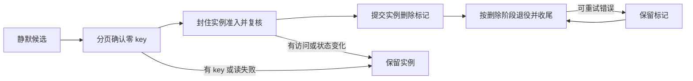

# 长期静默空实例自动回收设计

Instance Group 可以设置静默超时。只有 **同一个 `instance_id` 在完整静默窗口内没有访问、元数据确认零 key、没有在途操作** 时，Leader 才回收实例。有效心跳和带实例 ID 的 `GetClusterInfo` 都会刷新活跃度。已有组默认关闭，注册、启用和进程恢复后从新的完整窗口起算。

本 PR 实现单进程部署下从组配置、访问统计、判空到条件删除的完整流程。Redis HA 的跨节点观测和跨任期提交保护单独评审。

`RegistryManager` 持久化实例注册信息，`MetaIndexer` 管理该实例的 block key，`CacheManager` 编排回收。现有 `CacheGarbageCollector` 按 key 和 Location 清理失效元数据，Admin `RemoveInstance` 会主动 Trim 实例内的缓存。自动回收使用条件删除入口，确认空后复用实例退役和注册表收尾。 [模块架构](module_architecture.md) · [后台扫描 GC](cache_garbage_collector.md) · [手工删除实现](../../kv_cache_manager/manager/cache_manager.cc)

## 1. 空闲时的实例流量

RTP-LLM 的 KVCM publisher 在没有推理请求时仍可发送 `EVENT_HEARTBEAT`。客户端初次发现 Leader 或刷新地址时也可以发送带实例 ID 的 `GetClusterInfo`。这些请求只刷新所携带 ID 的活跃时间。一个部署注册多个 ID 时，各 ID 独立计时。空 ID 的 `GetClusterInfo` 只查询集群信息。 [ReportEvent 实现](../../kv_cache_manager/manager/cache_manager.cc) · [Leader 发现](ha_leader_elector.md)

## 2. 组配置与静默窗口

`InstanceGroup.empty_instance_idle_timeout_seconds` 为非负 `int64`，单位为秒，缺省值和 `0` 都表示关闭。旧注册表和启动 JSON 缺字段时读作关闭。通过现有 Admin API 配置该值，proto 用已有的 `Int64Value` 区分缺省和显式 `0`。更新时在组版本校验内处理字段缺省，沿用当前值，兼容旧工具更新其他属性。 [JSON 配置](../../kv_cache_manager/config/instance_group.cc) · [Admin proto](../../kv_cache_manager/protocol/protobuf/admin_service.proto) · [proto 转换](../../kv_cache_manager/service/util/manager_message_proto_util.cc)

每个启用的实例用 `steady_clock` 记录最近访问时间。观察到新注册、策略启用、组配置换版或实例恢复后，扫描器从当前时刻开始计时，留出一个完整窗口。最近访问只保存在运行时。扫描读取最新组配置，提交时检查实例记录和组配置是否仍匹配。静默时间足够时，最后一个 key 被清理后即可进入下一轮判空。 [组版本更新](../../kv_cache_manager/config/registry_manager.cc)

## 3. 访问统计与启用范围

| 请求 | 计时规则 |
| --- | --- |
| 带已注册实例 ID 的 Meta 请求 | HTTP 解析和 gRPC 接收后，在入队前刷新，包括读、写、缓存 miss、实例查询和 `ReportEvent`。业务层失败仍保留这次访问。 |
| `RegisterInstance` | 新实例注册后初始化。携带已注册 ID 的注册请求参与续期。 |
| 带已注册实例 ID 的 `GetClusterInfo` | 本进程接纳后刷新对应实例。 |
| 全局探测和内部维护 | 空 ID 的 `GetClusterInfo`、健康检查、实例列表、GC 和 Reclaimer 只执行各自的操作。 |

HTTP 和 gRPC 共享按实例的准入状态。业务请求入队前保留当前实例的访问引用，在执行完成、取消或入队失败后释放。计时覆盖可归属到已注册实例的 Meta 请求入口。实例删除和后台任务通过已有的删除保护、运行时对象引用和元数据变更校验参与并发控制。业务请求使用进程内状态记录访问。 [Meta 服务实现](../../kv_cache_manager/service/meta_service_impl.cc) · [服务端生命周期](../../kv_cache_manager/service/server.cc)

### 3.1 当前 PR 的启用条件

回收只在使用进程内协调后端的单 KVCM 进程部署中启用。默认协调配置和显式 `memory://` 都创建该后端，服务端按实际生效的协调后端判断。注册表和 block 元数据仍可使用 Redis。使用 Redis 或文件协调时，组配置可以保存，服务端保留实例。 [协调配置](ha_leader_elector.md) · [协调后端选择](../../kv_cache_manager/config/coordination_backend_factory.cc)

Redis HA 由后续 PR 处理。Follower 能接纳带实例 ID 的 `GetClusterInfo`，因此需要跨节点汇总这些访问，并在回收提交时和并发访问排序。HA 自动删除还需在切主和恢复期间校验任期及实例身份，避免迟到的删除操作影响同 ID 的新实例。 [HA 请求路径](ha_leader_elector.md)

## 4. 判空与删除提交

Leader 在恢复后启动低频实例扫描，按启用组枚举候选。`DoRecover()` 可能把部分恢复交给后台重试，候选须同时具备完整注册信息和已就绪的 indexer。以实例为单位推进各阶段，按轮限制并发、Redis 页数和 I/O，未完成的探测保留游标供后续推进。达到静默超时即有资格进入扫描，实际回收还受扫描预算和后端可用性影响。普通 key/Location GC 开关由原路径管理，实例回收由组策略控制。 [恢复与实例管理](../../kv_cache_manager/manager/cache_manager.cc) · [普通 GC 启动](../../kv_cache_manager/manager/cache_garbage_collector.cc)

### 4.1 判空范围

零 key 指该实例的完整 block key 空间为空。只有属性或空 Location 的条目也算 key，含 WRITING、SERVING、DELETING 或 EventReport Location 的条目同样保留实例。使用无副作用的读取，已有 key 计数可作为扫描提示。该计数可能因 failover 偏离实值，删除由实际存储决定。 [MetaIndexer](../../kv_cache_manager/meta/meta_indexer.cc)

| 元数据模式 | 判空依据 |
| --- | --- |
| Local 或 Simple | 对该实例实际的本地 key 空间做存在性探测。 |
| Redis 或 Async Redis | `SyncAll` 成功后，用 Redis `SCAN MATCH` 探测持久层，对实例的字面 key 前缀做 glob 转义。出现任意 key 即结束。只有游标走回 `0` 且全程零 key 才确认空。 |
| 内存与 Redis 双层 | 同时检查本地和持久层。内存主存储模式先完成异步写屏障，再读取 Redis。 |

读取错误、屏障失败、恢复未完成和游标未结束都保留实例。`MetaStorageBackendManager::ListPersistentKeys` 能直接读取持久层。普通 `Scan` 在双层 Running 时通常读取内存，普通 GC 的 maintenance view 也可能省略 Redis 冷 key。 [元数据后端的扫描入口](../../kv_cache_manager/meta/meta_storage_backend_manager.cc) · [Redis 前缀扫描](../../kv_cache_manager/common/redis_client.cc)

### 4.2 并发提交顺序

1. **取候选。** 捕获实例身份、组配置和活动序号。仍有业务请求、写会话或 EventReport 已调度的元数据收尾时，引用阻止提交。扫描开始时读取 indexer 的元数据变更序号，提交前检查该序号以及迁移和对象引用。
2. **核实元数据。** 在后台完成写屏障和分页探测。请求可继续访问。任何活动或元数据变更使旧候选及其游标失效。这样可以把一次 Redis 前缀扫描摊开，同时缩短封住单个实例准入的时间。
3. **提交条件删除。** 在按实例的短临界区内尝试关闭准入，复核在途计数、静默窗口、运行时代际和探测期间的变更序号。遇到仍在途的请求、写会话或后台任务就跳过本轮。关闭由实例状态表示，释放内存锁后再检查当前 Leader 门禁并执行 Registry 提交。访问先获得准入时刷新窗口，删除先关闭准入时阻止该代际继续写入。确认提交条件失败时恢复准入。
4. **持久化并收尾。** 在 Registry 已有临界区内检查实例仍是同一条注册记录且组版本匹配，提交 `kDeleting` 并记录自动回收原因和删除 ID。复用该状态阻止同 ID 并发注册，再复用已有的 searcher/indexer detach、owner drain、元数据 `Retire`、注册表 `CompleteRemoveInstance` 和 metrics 清理。自动回收只退役确认空的实例元数据与运行时对象，物理缓存由现有缓存回收路径处理。 [现有实例删除](../../kv_cache_manager/manager/cache_manager.cc) · [删除标记和终态](../../kv_cache_manager/config/registry_manager.cc) · [写会话](../../kv_cache_manager/manager/write_location_manager.h)

扫描沿用现有 Leader 生命周期。停止或失锁时先关闭自动删除准入，再等扫描和已接纳的任务退出，最后清理实例对象。 [现有失锁门禁](ha_leader_elector.md#323-失锁与业务门禁) · [元数据退役](../../kv_cache_manager/meta/meta_indexer.cc)

### 4.3 失败恢复与同 ID 重注册

确认删除标记未提交时恢复准入，实例可继续接纳访问。持久化结果不明时保留门禁，以同一删除 ID 对账或重试。已提交的自动删除在进程内有界重试，重启后在支持的单进程模式下读取注册表中的自动删除意图并接续。实例尚待退役时重新验证零 key，有残留时保留数据和删除意图并记录异常。确认已退役后仅完成注册表收尾。 [现有恢复入口](../../kv_cache_manager/manager/cache_manager.cc) · [注册表恢复](../../kv_cache_manager/config/registry_manager.cc)

单进程用运行时对象区分实例代际，重复注册沿用当前代际。删除期间同 ID 注册沿用 pending 门禁，收尾成功后同 ID 注册创建新代际并重新计时。已入队请求绑定原运行时对象，写会话和后台任务通过在途检查与已有引用排空收敛。组关闭回收后，已持久化的删除意图继续收尾。

## 5. 实现范围与锁粒度

- **回收专用改动。** 组级配置、按实例的访问登记、Leader 扫描、判空和条件删除组成核心路径。HTTP 和 gRPC 在既有请求入口挂接实例状态，沿用现有执行器。单进程的请求入口保留运行时实例引用，以覆盖策略启用前就已入队的请求。已观测的实例才更新活跃时间。Redis 字面前缀处理放到判空路径，普通扫描继续使用原有接口。
- **复用删除收尾。** 自动回收有独立条件入口，只复用删除标记、对象退役和注册表收尾。写会话、迁移和 EventReport 优先用现有状态或引用确认在途，自动候选遇忙跳过。
- **按实例短时协调。** 请求从共享表中取得实例状态，然后在实例锁内更新时间或关闭准入。扫描器遇到活跃迁移或仍有引用时跳过。摘除对象和清理 metrics 时短时复用 `metrics_lifecycle_->mut_`。分页扫描、`SyncAll`、退役和重试在这些锁之外执行。注册表的删除标记和收尾复用已有 Registry 写锁及其 I/O 超时。 [手工删除](../../kv_cache_manager/manager/cache_manager.cc) · [注册表写入](../../kv_cache_manager/config/registry_manager.cc) · [现有生命周期锁](../../kv_cache_manager/metrics/metrics_lifecycle.h)

## 6. 可观测性与验收

现有访问日志可用于核对保活来源。自动回收日志记录成功释放的实例，以及已进入删除阶段但判空或退役失败的实例。

| 场景 | 验收条件 |
| --- | --- |
| 配置与启用条件 | 老配置和 `0` 关闭回收。启用和修改超时后至少等待完整的新窗口。Redis 或文件协调部署即使组超时为正也保留实例。 |
| 访问归属 | 零推理但同 ID 有心跳时保留。心跳业务返回失败仍刷新已注册实例。带实例 ID 的 `GetClusterInfo` 参与续期，空 ID 探测只用于集群发现。 |
| 判空 | 纯 Local、Simple、Redis 和双层各验证零 key。内存空但 Redis 有 key、Redis 中间页为空但游标非零、异步写失败等情况不会提前提交。 |
| 竞争与锁粒度 | 在排队、探测结束和提交前分别注入注册、写入或 `ReportEvent`，验证访问先获得准入时保留，提交先获得准入时旧代际无法再写入。阻塞 A 的扫描、写屏障及引用排空，同时执行 B 的读写，检查 B 能继续完成请求。 |
| 重启与重试 | 注入删除标记结果不明、元数据退役失败和注册表收尾失败。验证进程内重试及重启接续，存活实例重新计时，同 ID 在收尾后可以注册。 |
| RTP-LLM 灰度 | 用实际镜像按 ID 检查 `ReportEvent`、`GetClusterInfo` 和注册访问，覆盖纯远端缓存和 HBM 与远端缓存同时启用。要保留的在线 ID 在零推理跨过一个超时窗口后仍能续期。停进程并确认 key 清零后，等待自动回收并验证同 ID 重注册。 |

单测可复用 `CacheManagerTest` 中的 owner drain、Redis 残留和收尾失败用例。灰度在本 PR 支持的单进程部署进行，先核对实际访问和候选，再为验证过的组配置非零超时。如果同一组有应保留的在线 ID 缺少续期源，组继续使用 `0`，直到这些实例有可观测的保活。 [CacheManager 测试](../../kv_cache_manager/manager/test/cache_manager_test.cc) · [访问日志配置](../configuration.md)
