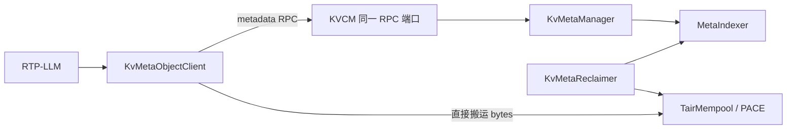
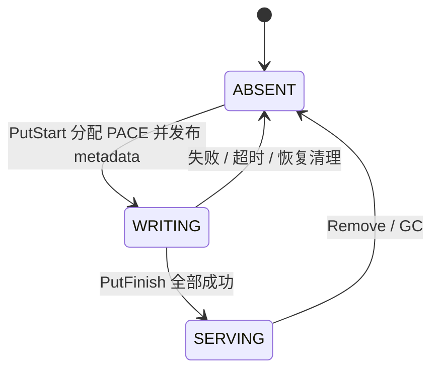

# KVMeta EMB Cache 设计与实现

## 1. 总体设计

KVMeta 为 EPD/多模态场景提供变长 embedding cache：

- KVCM 管理 key、对象长度、PACE 地址、状态、用量和 GC。
- embedding bytes 由客户端直接读写 TairMempool/PACE，不经过 KVCM Server。
- KVMeta 与原 MetaService 共用 RPC 端口，但使用独立 protobuf service、instance schema 和 Reclaimer。
- V1 仅支持 TairMempool DRAM/SSD，不修改普通 KVCache 和 TairMempool provider。
- KVMeta 是旁路 cache；miss、容量不足或 I/O 失败时，RTP 必须能重新计算 embedding。



核心取舍：

1. 对象不可变：相同 key、相同 size 视为命中，不覆盖旧值。
2. 只有 `SERVING` 对象可读、计入 usage。
3. `PutStart` 不加容量锁、不预留空间，允许短暂超调。
4. GC 根据已提交字节异步回收到目标水位。
5. 删除按 generation 条件执行，不能误删同 key 的新对象。

## 2. 数据模型

### 2.1 Instance 隔离

公共 instance id 被编码为独立内部 ID：

```text
__kv_meta_v1__<hex(public_instance_id)>
```

KVMeta instance 使用完整 schema marker：

```text
block_size       = 1
location_spec    = { "value": 1 }
model_name       = "__kv_meta_object__"
dtype            = "opaque_bytes"
deployment.extra = "kv_meta_v1"
```

`1` 只是注册协议的 schema marker，不是对象大小。KVMeta group 必须专用；普通 GC/Reclaimer 跳过 KVMeta instance，KVMeta Reclaimer 也不会处理混有普通 instance 的 group。

### 2.2 Key 和 Location

```text
internal_key = Hash64(business_key)
location_id  = "kvmeta:v1:" + hex(business_key)

CacheLocation {
  status: WRITING | SERVING
  type: TAIR_MEMPOOL | TAIR_MEMPOOL_SSD
  create_time: <generation time>
  spec: { name: "value", uri: "pace://...?size=<actual-bytes>" }
}
```

完整业务 key 保存在 location id 中，用于区分 64 位 hash 冲突。服务端和客户端都校验 storage type、backend、URI 和真实 size。

Generation 由 location id、type、create time 和完整 URI 等字段共同确定。`WRITING -> SERVING` 不改变 generation。

## 3. 状态机和请求流程



### 3.1 写入

1. 客户端校验 key、对象真实大小和 buffer。
2. `PutStart` 查询 exact key：
   - `SERVING` 且 size 相同：返回 hit。
   - `SERVING` 但 size 不同：返回 `SIZE_MISMATCH`。
   - `WRITING`：返回 `WRITE_IN_PROGRESS`。
3. 对 miss 使用真实 size 向 PACE 分配空间。
4. 条件创建 `WRITING` metadata，并记录有期限的内存 write session。
5. 客户端直接向 PACE 写 bytes。
6. 客户端确认全部数据面写入已结束后调用 `PutFinish`；全部成功时，条件执行 `WRITING -> SERVING` 并增加 usage。
7. 任一失败则清理本 session 的全部 generation，并尽力释放 allocation。

多 key session 提供整批最终成功/失败语义，但不保证多个 key 同时线性化可见。

超时不能证明后台 I/O 已停止。未收到客户端结束确认的 `WRITING` 只清理 metadata，保留 allocation，避免旧写入污染复用地址。

### 3.2 读取

1. `Get` 只返回 `SERVING` 对象的 URI 和 `value_size`。
2. object client 要求整批命中，并校验目标 buffer 字节数。
3. PACE SDK 直接写入调用方 CPU/CUDA buffer。

读取失败后必须丢弃全部目标 buffer，因为报错前可能已发生部分写入。

当前 C++ client 在 PACE Load 后不做第二次 metadata Get。读删除并发依赖 `delay_before_delete_ms`：它必须覆盖最长读取时间及调度抖动。

### 3.3 删除

1. 读取当前 exact generation。
2. 对 `WRITING` 返回 `WRITE_IN_PROGRESS`。
3. 按 generation 条件删除 metadata。
4. 删除成功才扣 usage。
5. 确认 metadata 删除已持久化，否则保留 allocation 并返回错误。
6. 等待 `delay_before_delete_ms` 后，best-effort 删除 PACE allocation；等待被降主/退出打断时保留 allocation。

不存在的 key 视为删除成功。transport error 时结果可能未知，不能盲目重试。

## 4. 变长对象实现

对象真实长度同时出现在：

```text
PutStartRequest.value_sizes[i]
PACE URI 的 size
本地 tensor/buffer 的总字节数
```

三者必须一致。`KvMetaTransferClient` 持有私有 PACE SDK client，每批 I/O 前按本批对象长度更新 `spec_byte_sizes_per_block`。该配置不影响普通定长 TransferClient，也不需要修改 TairMempool provider。

同一个 object client 的 Save/Load 串行执行，并在 `PutStart` 前取得 data-plane mutex，避免本地排队消耗 write lease。不同 client 仍可并发，由服务端条件写协调。

SDK 超时或抛异常后会销毁私有 wrapper 并等待后台任务退出，防止旧任务继续访问 buffer 或已经释放的 allocation；该 data-plane client 随后不再可用。

## 5. 容量统计和准入

### 5.1 Usage

```text
instance_usage[type] = Σ 当前 SERVING 对象的 value_size
group_usage          = Σ group 内全部 KVMeta instance_usage
```

每个 `MetaIndexer` 使用按 storage type 划分的原子计数器：

| 操作 | Usage |
|---|---|
| 创建/清理 `WRITING` | 不变 |
| `WRITING -> SERVING` 成功 | 增加真实 size |
| Remove/GC 成功删除 `SERVING` | 减少真实 size |
| 条件删除失败 | 不变 |
| PACE 物理删除失败 | 不恢复 |

metadata 发布、提交和删除使用同一把 instance 分片 mutation lock，使 usage 更新和持久化删除确认不与新 generation 交叉；PACE 分配不持有该锁。

usage 是逻辑已提交字节，不等于 PACE 物理占用，不包含：

- `WRITING` allocation。
- allocator 对齐和管理开销。
- metadata 已删除但物理删除失败、取消或无法确认写入停止而保留的孤儿 allocation。
- PACE Create 后、metadata 发布前崩溃留下的 allocation。

### 5.2 快照准入

`PutStart` 只检查当前已提交 usage 是否达到 group/type capacity，不计算：

```text
current_usage + requested_bytes
```

也不加容量锁或创建 reservation。例如 capacity 为 100 GiB、usage 为 99 GiB 时，4 GiB 写入仍可继续并提交到 103 GiB。PACE allocator 决定物理分配是否成功，后台 GC 负责异步收敛。

`used_percentage=0.8` 是 GC 目标，不是写入拒绝线。

## 6. GC

有效容量和目标水位：

```text
capacity = min(group capacity, matching PACE tier quota)
target   = floor(capacity * used_percentage)
excess   = group_usage - target
```

当 `group_usage > target` 时，KvMetaReclaimer 执行：

1. 汇总 group 内全部 KVMeta instance usage。
2. 从每个 instance 的 persistent metadata keyspace 采样候选。
3. 若候选命中 metadata hot cache，用 hot-cache 最新访问时间覆盖 persistent 时间。
4. 合并全部候选，按访问时间升序排序。
5. 重新读取 metadata，只保留合法 `SERVING` generation。
6. 选择至多一个 batch，或预计删除字节达到 `excess`。
7. generation 条件删除 metadata；只有成功删除才扣 usage。
8. 确认删除已持久化，再等待 reader grace period，best-effort 删除 PACE allocation。
9. 后续轮次继续采样，直到 usage 回到 target 以下。

这是异步采样 LRU，不是每轮全量排序。persistent source 保证 hot-cache 淘汰的 key 仍有机会被回收；maintenance 查询不会刷新 LRU。

当前没有 KVMeta `DELETING` tombstone，也没有物理删除失败的持久化重试队列。逻辑 cache 会立即 miss，但 PACE 可能留下孤儿 allocation。

## 7. 恢复和服务隔离

升主后启动 KVMeta maintenance worker，等待 Registry 完整恢复及相关 MetaIndexer 创建完成，在首轮 GC 前扫描 persistent metadata：

- 删除遗留 `WRITING` metadata，保留可能仍被旧客户端写入的 allocation。
- 汇总全部合法 `SERVING` size。
- 重建每个 MetaIndexer 的 usage。

恢复完成前 KVMeta 返回 `SERVICE_NOT_READY`，不阻塞原 MetaService。KVMeta 不信任可能滞后的持久化 usage，而以对象 metadata 扫描结果重建。

降主或停服时先关闭 KVMeta 新请求，再停止 session/reclaimer worker并等待在途请求完成。write session 不持久化，遗留 `WRITING` 由下一任 Leader 清理。

## 8. RTP-LLM 接入

RTP facade 复用现有 `RECO_*` endpoint、VIPServer、PACE SDK 和 timeout，不增加 EMB 专用环境变量。

```text
RECO_INSTANCE_GROUP=pace_group_m3

派生：
instance_group = kve_pace_group_m3
instance_id    = kve_pace_group_m3
```

若配置 `RECO_INSTANCE_ID_SALT=model-a`，instance id 为 `kve_model-a`。运维需要提前创建派生后的专用 group；client 自动注册 instance，但不创建 group。

```python
import torch

from kv_cache_manager.client import KvMetaObjectClientError
from rtp_llm.multimodal.kvcm import RtpKvMetaObjectClient


emb_cache = RtpKvMetaObjectClient()


def get_embedding(key, shape, encode, request_id):
    output = torch.empty(shape, dtype=torch.float32)
    try:
        if emb_cache.try_load_one(key, output, trace_id=request_id):
            return output
    except KvMetaObjectClientError:
        pass

    embedding = encode()
    try:
        emb_cache.save_one(key, embedding, trace_id=request_id)
    except KvMetaObjectClientError:
        pass
    return embedding
```

业务 key 必须包含 tenant、模型/预处理版本、内容 digest、shape、dtype、layout 和 cache schema。稳定共享 key 不应在每次读取后 Remove，正常淘汰交给 Reclaimer。

RTP 仍负责 singleflight、回源、内容校验、poisoned entry 修复、指标和 EPD 调度；facade 只提供 exact-object cache primitive。

## 9. 失败语义与限制

| 场景 | 处理 |
|---|---|
| Get miss | 重算 embedding |
| PACE allocation/I/O 失败 | cache 失败，推理继续 |
| PutFinish/Remove transport error | 结果可能未知，不盲目重试 |
| session 超时或恢复遇到 `WRITING` | 条件清理 metadata，保留 allocation |
| PACE Delete 失败 | metadata 已 miss，记录孤儿风险 |
| Leader 恢复未完成 | KVMeta 暂不可用，普通 MetaService 不受影响 |

V1 不提供强一致容量 reservation、跨 key 原子可见、持久化 session、read lease、内容 checksum、多 tier 混合存储和 `Trim` handler。

PACE 接口尚无写入隔离机制。KVMeta 无法安全自动回收未获客户端结束确认的 allocation，因此这些孤儿仍占物理容量。

主要限制：

| 项目 | 上限 |
|---|---:|
| native batch | 64 objects |
| key / instance id / group | 512 bytes |
| 单对象 | 1 GiB |
| 单批总大小 | 4 GiB |
| 活跃 write session | 4096 |
| write timeout | 1800 秒 |

## 10. 实现细节

### 10.1 Session 和回滚

- session 使用 `steady_clock` deadline，避免系统时间回拨。
- session map 满时，在创建新 PACE allocation 前拒绝请求。
- 后台超时只清理 metadata；显式 `PutFinish` 确认全部写入停止后，才可释放 allocation。metadata 清理失败转为 cleanup-only session，每秒重试。
- PACE Create 成功但 metadata 尚未发布时失败，直接 best-effort Delete。
- 若进程恰在 Create 后、metadata 发布前崩溃，Leader recovery 无法从 metadata 发现该 allocation。

### 10.2 部分提交

底层 metadata batch 可能部分成功。实现记录已经 `SERVING` 的项及其 usage；整批未全部成功时，释放 mutation lock 后清理本 session 的所有 generation，已提交项在清理时扣回 usage。

### 10.3 Hash 冲突

索引使用 64 位 hash，完整 key 保存在 location id。批量操作将相同 hash 拆成不同 unique-key layer，因此冲突不会导致两个业务 key 相互覆盖。

### 10.4 删除顺序

```text
条件删除 metadata
    -> 扣减 SERVING usage
    -> 等待 delay_before_delete_ms
    -> best-effort PACE Delete
```

该顺序优先保证缓存立即 miss 和主链路不被物理删除故障阻塞，代价是物理 usage 可能与逻辑 usage 偏离。

### 10.5 测试覆盖

- [`kv_meta_manager_test.cc`](../../kv_cache_manager/manager/test/kv_meta_manager_test.cc)：状态机、session、usage、软容量、恢复和 GC。
- [`kv_meta_service_impl_test.cc`](../../kv_cache_manager/service/test/kv_meta_service_impl_test.cc)：RPC shape、错误码和 leader gate。
- [`kv_meta_object_client_test.cc`](../../kv_cache_manager/client/test/kv_meta_object_client_test.cc)：metadata/数据面编排、回滚和生命周期。
- [`kv_meta_transfer_client_test.cc`](../../kv_cache_manager/client/test/kv_meta_transfer_client_test.cc)：exact-size I/O 和 timeout。
- [`kv_meta_object_client_py_test.py`](../../kv_cache_manager/client/test/kv_meta_object_client_py_test.py)：Python batching、异常和 Close。
- RTP：`mm_kvcm_emb_config_test.py`、`mm_kvcm_emb_client_test.py`、`mm_kvcm_emb_client_integration_test.py`。

### 10.6 代码索引

- [`kv_meta_service.proto`](../../kv_cache_manager/protocol/protobuf/kv_meta_service.proto)
- [`server.cc`](../../kv_cache_manager/service/server.cc)
- [`kv_meta_manager.cc`](../../kv_cache_manager/manager/kv_meta_manager.cc)
- [`kv_meta_instance.h`](../../kv_cache_manager/manager/kv_meta_instance.h)
- [`meta_storage_backend_manager.cc`](../../kv_cache_manager/meta/meta_storage_backend_manager.cc)
- [`storage_usage_data.cc`](../../kv_cache_manager/meta/storage_usage_data.cc)
- [`kv_meta_object_client_impl.cc`](../../kv_cache_manager/client/src/kv_meta_object_client_impl.cc)
- [`kv_meta_transfer_client_impl.cc`](../../kv_cache_manager/client/src/kv_meta_transfer_client_impl.cc)
- [`kv_meta_object_client.py`](../../kv_cache_manager/client/kv_meta_object_client.py)

## 11. Review 重点

1. `delay_before_delete_ms` 是否覆盖线上最大读取耗时；否则需要增加 Load 后 generation 校验。
2. 是否具备 PACE 物理用量、Delete 失败和孤儿 allocation 告警。
3. 生产 metadata/Registry 是否持久化，保证重启后能重建 usage 和 allocation ownership。
4. RTP key 是否完整包含内容和版本信息，并实现热点 miss singleflight。
5. 是否接受无容量 reservation 带来的短暂超调和 PACE 分配失败回退。
6. RTP 文档不得宣称当前支持 NFS、`DELETING` tombstone或 post-load generation fence。
