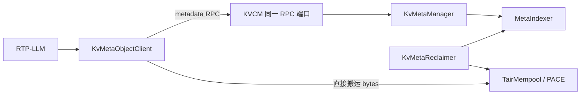
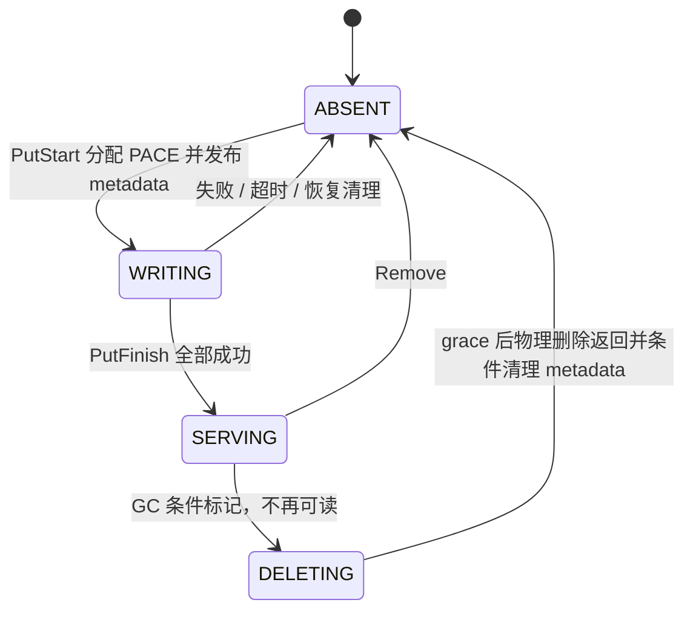

# KVMeta EMB Cache 设计与实现

## 1. 总体设计

KVMeta 为 EPD/多模态场景提供变长 embedding cache：

- KVCM 管理 key、对象长度、PACE 地址、状态、用量和 GC。
- embedding bytes 由客户端直接读写 TairMempool/PACE，不经过 KVCM Server。
- KVMeta 与原 MetaService 共用 RPC 端口，但使用独立 protobuf service、instance schema 和 Reclaimer。
- V1 仅支持 TairMempool DRAM/SSD，不修改普通 KVCache 和 TairMempool provider。
- KVMeta 是旁路 cache；miss、容量不足或 I/O 失败时，RTP 必须能重新计算 embedding。



核心取舍：

1. 对象不可变：相同 key、相同 size 视为命中，不覆盖旧值。
2. 只有 `SERVING` 对象可读。usage 包含已提交对象、尚未清理的 `DELETING`，以及提交结果未确认时的保守计量。
3. `PutStart` 不加容量锁、不预留空间，允许短暂超调。
4. GC 根据已提交字节异步回收到目标水位。
5. 删除按 generation 条件执行，不能误删同 key 的新对象。

## 2. 数据模型

### 2.1 Instance 隔离

公共 instance id 被编码为独立内部 ID：

```text
__kv_meta_v1__<hex(public_instance_id)>
```

KVMeta instance 使用完整 schema marker：

```text
block_size       = 1
location_spec    = { "value": 1 }
model_name       = "__kv_meta_object__"
dtype            = "opaque_bytes"
deployment.extra = "kv_meta_v1"
```

`1` 只是注册协议的 schema marker，不是对象大小。KVMeta group 必须专用；普通 GC/Reclaimer 跳过 KVMeta instance，KVMeta Reclaimer 也不会处理混有普通 instance 的 group。

KVMeta 支持 local metadata 或同步持久化 metadata，可配 local hot cache；不支持 `memory_primary=true` 的异步备份模式。后者可能丢弃尚未持久化的备份，使恢复扫描与容量回收无法覆盖全部已提交对象。生产环境应使用可恢复的 Registry 和 metadata 配置。

### 2.2 Key 和 Location

```text
internal_key = Hash64(business_key)
location_id  = "kvmeta:v1:" + hex(business_key)

CacheLocation {
  status: WRITING | SERVING | DELETING
  type: TAIR_MEMPOOL | TAIR_MEMPOOL_SSD
  create_time: <generation time>
  spec: { name: "value", uri: "pace://...?size=<actual-bytes>" }
}
```

完整业务 key 保存在 location id 中，用于区分 64 位 hash 冲突。服务端和客户端都校验 storage type、backend、URI 和真实 size。

Generation 由 location id、type、create time 和完整 URI 等字段共同确定。`WRITING -> SERVING` 不改变 generation。

## 3. 状态机和请求流程



### 3.1 写入

1. 客户端校验 key、对象真实大小和 buffer。
2. `PutStart` 查询 exact key：
   - `SERVING` 且 size 相同：返回 hit。
   - `SERVING` 但 size 不同：返回 `SIZE_MISMATCH`。
   - `WRITING` 或 `DELETING`：返回 `WRITE_IN_PROGRESS`，本次不写入。`DELETING` 已不可读，等待当前回收任务完成。
3. 对 miss 按真实 size 分组，复用 PACE 批量 Create；返回 location 仍保持请求顺序。分配或后续 metadata 发布失败时，释放尚未公布的私有分配，并对已公布项做 generation 保护的清理。
4. 复用 MetaIndexer 批量 RMW 条件创建 `WRITING` metadata；hash 冲突按 unique-key layer 拆分，返回和 session 顺序仍按请求对齐，并记录有期限的内存 write session。
5. 客户端直接向 PACE 写 bytes。
6. 客户端确认全部数据面写入已结束后调用 `PutFinish`；发布 `SERVING` 前先记入 usage，并保留提交未确认标记。全部提交成功后清除该标记；提交未确认的 generation 由专用 cleanup 退还计量，GC 暂不竞争它的删除归属。
7. 已确认全部远端 I/O 停止后的失败，可清理本 session 的全部 generation，并尽力释放 allocation；状态未知时不发送 `PutFinish`，等待 session 过期只清理 metadata。

多 key session 提供整批最终成功/失败语义，但不保证多个 key 同时线性化可见。

超时不能证明后台 I/O 已停止。未收到客户端结束确认的 `WRITING` 只清理 metadata，保留 allocation，避免旧写入污染复用地址。

### 3.2 读取

1. `Get` 只返回 `SERVING` 对象的 URI 和 `value_size`，返回前在 shard fence 下复核 generation；并发删除或替换使原 generation 失效时返回 miss。
2. object client 要求整批命中，并校验目标 buffer 字节数。
3. PACE SDK 直接写入调用方 CPU/CUDA buffer。

读取失败后必须丢弃全部目标 buffer，因为报错前可能已发生部分写入。

当前 C++ client 在 PACE Load 后不做第二次 metadata Get。读删除并发依赖 `delay_before_delete_ms`：它必须覆盖从获得 URI 到远端读取实际完成的时间及调度抖动。RTP 的前置 size 查询不缓存数据面 URI，真正 Load 仍由 native client 重新获取 location；后续 CPU 解包使用已取得的本地 buffer。

### 3.3 删除

1. 读取当前 exact generation。
2. 对 `WRITING` 返回 `WRITE_IN_PROGRESS`。
3. 按 generation 条件删除 metadata。
4. 删除成功才扣 usage。
5. 确认 metadata 删除已持久化，否则保留 allocation 并返回错误。
6. 等待 `delay_before_delete_ms` 后，best-effort 删除 PACE allocation；等待被降主/退出打断时保留 allocation。

不存在的 key 视为删除成功。transport error 时结果可能未知，不能盲目重试。

### 3.4 删除 Instance

`RemoveInstance` 是异常情况下的管理操作，不是正常容量回收入口。Admin API 使用编码后的内部 instance id；该 id 可从 `kvcm_ops list_instance` 获取。

1. Registry 阻止该注册继续接收新请求，移出并排空对应 MetaIndexer 的使用者。
2. KVMeta 分支不调用普通固定块 Trim，也不物理释放 PACE 地址，避免与旧读写或已排队的 GC 任务争用 allocation。
3. `MetaIndexer::RetireKvMeta` 同步 metadata 后扫描并删除此 instance 的全部对象记录，再退休索引计量。扫描/同步失败时返回错误，不把未完成清理报告成成功。
4. 完成注册移除后才允许同一公共 ID 重新注册。旧写会话还须通过 registration 对象校验，不能提交到新注册生命周期。

该操作会使旧对象全部 miss，但保留的远端 allocation 仍可能占用 PACE 容量；不能把删除 instance 当成物理容量已释放。日常淘汰应使用后台 GC，按 key 主动删除使用 `Remove`。

## 4. 变长对象实现

对象真实长度同时出现在：

```text
PutStartRequest.value_sizes[i]
PACE URI 的 size
本地 tensor/buffer 的总字节数
```

三者必须一致。`KvMetaTransferClient` 持有私有 PACE SDK client，每批 I/O 前按本批对象长度更新 `spec_byte_sizes_per_block`。该配置不影响普通定长 TransferClient，也不需要修改 TairMempool provider。

同一个 object client 的 `Get` / `PutStart` 与数据传输在 data-plane mutex 内串行执行，避免地址或 write lease 在本地传输排队期间失效。确认传输成功结束后释放该锁，再执行 metadata-only 的 `PutFinish` 或 URI 不匹配回滚；OperationGuard 仍覆盖完整操作，使 `Close` 等待提交/回滚结束。不同 client 仍可并发，由服务端条件写协调。

原始 `ER_SDK_TIMEOUT` 或 SDK 抛异常时，transfer client 销毁私有 wrapper 并等待后台任务退出，该 data-plane client 随后不再可用。`ER_SDK_ERROR_BUFFER_SAFE` / `ER_SDK_TIMEOUT_BUFFER_SAFE` 则允许复用本地 buffer 和 client；它们不证明远端 allocation 可以释放，不能据此发送失败 `PutFinish`。

Python 注册的 host/GPU owner 由原生 holder 保活至 `Close` / SDK teardown 完成；注销 GPU 注册失败时保留相关 owner，并要求重启 worker。不能仅依赖 Python 动态属性的析构顺序。GPU 注销保护依赖配套的外源 SDK release-state 接口，PACE 适配与该 SDK 必须配对构建，不能用缺少接口的基线绕过保护。

## 5. 容量统计和准入

### 5.1 Usage

```text
instance_usage[type] = Σ 仍在计量中的 generation value_size
                       # 已提交的 SERVING/DELETING，以及提交未确认的 generation；每个 generation 只计一次
group_usage          = Σ group 内全部 KVMeta instance_usage
```

每个 `MetaIndexer` 使用按 storage type 划分的原子计数器：

| 操作 | Usage |
|---|---|
| 创建/清理尚未预记提交用量的 `WRITING` | 不变 |
| 发布 `SERVING` 前（包括提交结果未确认） | 先增加真实 size；确认成功后保留，失败确认清理后退还 |
| Remove 条件删除已提交对象 / GC 清理对应 `DELETING` metadata | 减少真实 size |
| 条件删除失败 | 不变 |
| PACE 物理删除失败 | 不恢复 |

metadata 发布、提交和删除按 instance 与 key 共同选择 mutation lock，批量操作按固定顺序获取锁。同 key 的 usage 更新、删除确认和新 generation 保持受保护，不同 key 可以并行；PACE 分配不持有该锁。写会话使用到期时间索引，避免每次新写入唤醒后扫描全部会话；默认最多 65536 个活动会话，并上报活动数和拒绝数。

usage 是逻辑已提交字节及未确认提交的保守计量，不等于 PACE 物理占用。提交结果或清理确认后计量收敛；不包含：

- `WRITING` allocation。
- allocator 对齐和管理开销。
- metadata 已删除但物理删除失败、取消或无法确认写入停止而保留的孤儿 allocation。
- PACE Create 后、metadata 发布前崩溃留下的 allocation。

### 5.2 快照准入

`PutStart` 只检查当前逻辑 usage 是否达到 group/type capacity，不计算：

```text
current_usage + requested_bytes
```

也不加容量锁或创建 reservation。例如 capacity 为 100 GiB、usage 为 99 GiB 时，4 GiB 写入仍可继续并提交到 103 GiB。PACE allocator 决定物理分配是否成功，后台 GC 负责异步收敛。

`used_percentage=0.8` 是 GC 目标，不是写入拒绝线。

## 6. GC

有效容量和目标水位：

```text
capacity = min(group capacity, matching PACE tier quota)  # tier quota 存在时；否则用 group capacity
target   = floor(capacity * used_percentage)
excess   = group_usage - target
```

当扣除仍有效的在途回收额度后 `group_usage > target` 时，KvMetaReclaimer 执行：

1. 复用普通 Cache 的采样入口；热缓存回填完成时在本地采样，恢复中从持久层采样。
2. 排除已在途 key；复用维护性 touch 让这些 key 让出冷分片采样位置，避免等待宽限期的 key 占满下一轮候选。
3. 合并候选并按访问时间排序，按需扩大批次读取 metadata，只保留合法且提交计量已确认的 SERVING generation。未确认提交的跳过次数见 `stage_count{stage=uncertain_commit,status=skipped}`。
4. 复用普通 Cache 的单批大小、每轮请求数、pending 对象数/字节数和超时配置，向 SchedulePlanExecutor 提交有界异步删除任务。
5. executor 校验预期 generation，将 metadata 标记为 DELETING，并按现有删除流程确认持久化。
6. executor 延迟调度完整 reader grace，不占 worker 睡眠；之后按 storage 分组执行物理删除。
7. 物理删除返回后条件清理 metadata、扣减 usage。删除失败不会恢复可读状态，也不会自动重试物理释放。
8. 超时任务停止抵扣预测回收额度，但保留 pending 去重和限额占用，避免重复释放；后续完成时再移除 pending。

这是异步采样 LRU，不是每轮全量扫描。普通 maintenance 读取不刷新业务访问时间；对已在途候选的维护性 touch 只调整本地采样顺序，不记录业务命中或写持久层。本地或 hot-cache 业务命中复用读取时已更新的访问时间，不重复 upsert；纯 Redis 命中仍更新持久化 LRU。

回收指标分别记录提交对象/字节、实际成功删除 metadata 的对象/字节和物理删除成功的对象/字节；任务完成批数不能当作对象回收 QPS。pending 最老时长、额度超时及限额跳过可用于定位停滞。当前没有长期 DELETING 的自动修复或物理失败持久化重试队列，失败或取消仍可能留下孤儿 allocation。读取安全要求 grace 覆盖完整读取时间及调度抖动。

关键观测项（`kv_meta.` 为 registry/KMonitor 名称前缀）：

- `reclaim.deleted_objects_total` / `reclaim.deleted_bytes_total`：实际 metadata 删除累计量。
- `reclaim.physical_deleted_objects_total` / `reclaim.physical_deleted_bytes_total`：物理删除成功累计量；与 metadata 删除量分开判断。
- `reclaim.pending_objects` / `reclaim.pending_bytes` / `reclaim.pending_requests`：全部未完成任务占用；`reclaim.pending_credit_bytes` 仅表示仍可抵扣的预测回收额度。
- `reclaim.pending_oldest_ms`、`reclaim.round_time_us` 和 `reclaim.stage_count`：排查慢任务、慢轮次、限额跳过与超时。
- `active_write_sessions`、`write_session_capacity`、`write_session_rejected_total`：会话容量和拒绝。
- `mutation_lock_wait_us` / `mutation_lock_hold_us` / `mutation_lock_count`：累计等待/持有微秒与次数，窗口增量相除得到平均耗时。

累计计数在 KMonitor 中按累计 Gauge 上报，应在查询侧计算窗口增量/时间；Prometheus 使用 counter 的 rate。例如对象回收速度为 `rate(kvcm_kv_meta_reclaim_deleted_objects_total[1m])`。旧 `reclaim.deleted_count` / `reclaim.deleted_bytes` 是最后完成批次的 Gauge，不代表每秒速度。

### 6.1 吞吐和容量预算

先看 `usage_bytes - target_bytes` 是否持续增大，再同时比较提交、metadata 删除和物理删除的对象/字节速率。普通 Cache 的 `reclaim_cron_count` 不能表示独立 KVMeta Reclaimer 的执行次数或对象回收速度。

回收复用普通 Cache 的 sampling/batching、sleep interval、每轮删除请求上限及 pending 限额。只调大 sample 不保证提速：若 `pending_limit` 持续跳过，需要结合 reader grace、删除耗时和 executor 排队检查在途预算。

```text
需要的在途对象数 ≈ 目标删除 key/s × (reader grace + 排队和删除耗时)
需要的在途字节数 ≈ 在途对象数 × 平均对象字节数
需要的在途请求数 ≈ 在途对象数 / 每批对象数
```

这些是配置预算估算，不是容量保证。实际应验证“持续写入时回收跟得上，停止写入后 pending 排空、usage 收敛”。只模拟对象 metadata 且不传 payload 的压测，可以验证元数据吞吐和回收调度，但不能据此宣称同等 QPS 的大对象带宽、GPU 传输或 PACE 磁盘吞吐已通过。

## 7. 恢复和服务隔离

升主后启动 KVMeta maintenance worker，等待 Registry 完整恢复及相关 MetaIndexer 创建完成，在首轮 GC 前扫描 persistent metadata：

- 删除遗留 `WRITING` metadata，保留可能仍被旧客户端写入的 allocation。
- 汇总全部合法 `SERVING` 和等待回收的 `DELETING` size。
- 重建每个 MetaIndexer 的 usage。

同一实例完整扫描按 internal key 去重，每个 key 下仍计量所有合法 location。单 key 在读取前消失时继续扫描；扫描本身失败时不发布该实例的 usage，也不标记 ready。

恢复完成前 KVMeta 返回 `SERVICE_NOT_READY`，不阻塞原 MetaService。KVMeta 不信任可能滞后的持久化 usage，而以对象 metadata 扫描结果重建。

KVMeta 的 usage 恢复与 hot-cache 回填是两个过程。hot cache 仍处于 `Recover` 时，读取和回收校验可回到持久层，并按需回填；不能用 hot-only miss 抹掉持久层的有效命中。回填失败不代表允许使用不完整缓存作为删除或 generation 校验的唯一依据。

降主或停服时先关闭 KVMeta 新请求，再停止 session/reclaimer worker并等待在途请求完成。write session 不持久化，遗留 `WRITING` 由下一任 Leader 清理。

## 8. RTP-LLM 接入

### 8.1 配置与实例

RTP facade 复用既有 `RECO_*` endpoint、VipServer 和 PACE SDK 配置。ViT 的缓存策略统一由 `MM_CACHE_CONFIG` JSON 配置，再映射到内部 ViT config 字段，不需要逐个新增环境变量。

```text
RECO_INSTANCE_GROUP=embedding_group

派生：
instance_group = kve_embedding_group
instance_id    = kve_embedding_group
```

若配置 `RECO_INSTANCE_ID_SALT=model-a`，instance id 为 `kve_model-a`。运维需要提前创建派生后的专用 group；client 自动注册 instance，但不创建 group。

JSON 格式示例，容量和 deadline 应按模型与实际负载设置：

```json
{
  "local": {"cpu_max_bytes": 0, "gpu_max_bytes": 0},
  "remote": {
    "enable": true,
    "namespace": "immutable-model-and-preprocess-revision",
    "gdr_enable": true,
    "max_pending": 64,
    "max_inflight_bytes": 4294967296,
    "read_timeout_ms": 1000,
    "write_timeout_ms": 1000
  }
}
```

关闭本地 CPU/GPU embedding cache 不会关闭远端能力。远端写入来自被接纳的 encoder result，不依赖 CPU cache 淘汰；临时 codec/staging buffer 也不是本地 CPU embedding cache。

`namespace` 必须标识不可变的权重和预处理版本。RTP 的 key prefix 会结合 namespace、模型配置和 dtype，但不会自动计算全部权重文件摘要；更新权重而沿用配置文件时，调用方仍需更新 namespace。业务 key 还应隔离 tenant、内容和 tensor/cache schema，不能让不同内容共享同一 `(instance_id, key)`。

### 8.2 实际读写流程

1. ViT 启动时构造一次 GDR transport，注册并复用独立 GPU arena；不会每次请求重新注册 client。
2. 请求先查可选本地 embedding cache；未命中时，由 `MMRemoteEmbeddingCache.load` 将远端读取提交给 IO worker。调用方等待有期限的 future，属于同步等待结果，不是预处理子进程提前取完数据。
3. 先查 metadata 得到对象大小，再由对象 SDK 查询/校验 location 并执行 Load；成功后解包并校验 tensor tree，将 CUDA tensor 恢复到目标设备。
4. miss、预算拒绝或读取失败时返回编码路径。有效 encoder result 在写入准入和快照后异步上传，cache 失败不丢弃本次模型计算结果。

当前读写共用两个 IO worker；`max_pending` 是读写合计的在途任务上限，不是线程数。注册 arena 的数据搬运串行复用，增大 admission 或 IO worker 数不等于线性增加 GDR 并发。多图请求也不能仅凭这个参数视为全部并行读取。

本地 `_pending_writes` 只去重同进程的重复写任务，不提供跨 worker 的全局 singleflight。同 key 已在写入/回收时可能得到 `WRITE_IN_PROGRESS`；新 RTP 实现将可确认未提交数据 I/O 的这类争用计为跳过，而不是传输失败。相同已提交对象则直接免写。

### 8.3 GDR 与 CPU 阶段

当前 RTP 封装的完整路径是：

```text
写：encoder tensor -> CPU 序列化快照 -> pinned host -> 注册 GPU arena -> PACE
读：PACE -> 注册 GPU arena -> pinned host -> CPU codec buffer -> 校验/解包 -> 目标 GPU tensor
```

GDR 表示 PACE 与注册 GPU arena 之间的 GPU 数据路径；不代表整个对象序列化、校验和恢复过程都绕过 CPU。`native_load` / `native_save` 还包含 SDK 的 metadata 调用，不能当作纯网络 RT。应结合 queue、metadata、transport lock、staging、checksum 和 restore 分阶段指标判断耗时。

### 8.4 超时、发现与观测

调用方读 deadline 限制 future 等待，超时即回源；不会强制终止后台 DMA。任务和字节预算保留至实际 worker 完成，已取消但仍执行的任务不能提前复用 buffer。对象恢复、CUDA 同步和 Close 也不由该 future deadline 强制中断，因此不能承诺整个 GPU 推理流程具有同一个硬 deadline。

KVMeta 数据面显式启用 `SdkWrapper` 的 completion wait：已开始的 I/O 等待后端真实完成，不能只因 wrapper 等待预算耗尽就销毁 Client 和 GPU 注册。普通 KVCache 保留原有 advisory deadline 行为。RTP 调用方仍按自己的 deadline 回源；后台任务完成前继续持有 buffer 和在途预算。后端自身必须提供有界完成或明确的 buffer-safe 错误，这一模式不提供强制 DMA 取消。

安全且已完成的 SDK 错误允许复用 client；无法确认 DMA 已停止时隔离 transport 并保留注册内存。ViT 安装故障恢复回调，在首条详细隔离日志之后以失败状态退出，由已有父进程监护和部署平台重启；不在仍存活的失效进程内重新注册另一块 arena，也不继续以健康状态永久回源。独立 SDK 用户未安装此回调时仍需自行重启进程。服务发现刷新只更新 metadata 端点，不销毁重建正在复用的 GDR arena；刷新失败先回源，不盲目重放写入。

正常成功通过指标观察，不逐请求打印成功日志。异常日志应带 operation、stage、trace_id、错误类型/错误码、字节数和耗时；读取总量还需区分 hit、miss、timeout 与 admission skip。计数应满足 `total = success + error + skipped`，miss 属于成功的 metadata 查询。caller timeout 后的晚到错误是补充诊断，不能重复计为新的请求失败。

KVCM 不做 payload checksum。RTP 负责格式与完整性校验和回源；校验失败不代表当前实现会主动删除并修复损坏对象，最终可由正常淘汰或新的 namespace 移除其影响。对象 SDK 的独立 Python 用法见 [client README](../../kv_cache_manager/client/README.md)，不应以单次 SDK Save/Load 测试替代 ViT 模型链路验收。

## 9. 失败语义与限制

| 场景 | 处理 |
|---|---|
| Get miss | 重算 embedding |
| PACE allocation/I/O 失败 | cache 失败，推理继续 |
| PutFinish/Remove transport error | 结果可能未知，不盲目重试 |
| session 超时或恢复遇到 `WRITING` | 条件清理 metadata，保留 allocation |
| PACE Delete 失败 | metadata 已 miss，记录孤儿风险 |
| Leader 恢复未完成 | KVMeta 暂不可用，普通 MetaService 不受影响 |

V1 不提供强一致容量 reservation、跨 key 原子可见、持久化 session、read lease、内容 checksum、多 tier 混合存储和 `Trim` handler。

PACE 接口尚无写入隔离机制。KVMeta 无法安全自动回收未获客户端结束确认的 allocation，因此这些孤儿仍占物理容量。

主要限制：

| 项目 | 上限 |
|---|---:|
| native batch | 64 objects |
| key / instance id / group | 512 bytes |
| 单对象 | 1 GiB |
| 单批总大小 | 4 GiB |
| 活跃 write session | 默认 65536，见 `kKvMetaMaxActiveWriteSessions` |
| write timeout | 1800 秒 |

## 10. 实现细节

### 10.1 Session 和回滚

- session 使用 `steady_clock` deadline，避免系统时间回拨。
- session map 满时，在创建新 PACE allocation 前拒绝请求。
- 后台超时只清理 metadata；显式 `PutFinish` 确认全部写入停止后，才可释放 allocation。metadata 清理失败转为 cleanup-only session，每秒重试。
- PACE Create 成功但 metadata 尚未发布时失败，直接 best-effort Delete。
- 若进程恰在 Create 后、metadata 发布前崩溃，Leader recovery 无法从 metadata 发现该 allocation。

### 10.2 部分提交

底层 metadata batch 可能部分成功。实现记录已经 `SERVING` 的项及其 usage；整批未全部成功时，释放 mutation lock 后清理本 session 的所有 generation，已提交项在清理时扣回 usage。

### 10.3 Hash 冲突

索引使用 64 位 hash，完整 key 保存在 location id。批量操作将相同 hash 拆成不同 unique-key layer，因此冲突不会导致两个业务 key 相互覆盖。

### 10.4 删除顺序

```text
条件删除 metadata
    -> 扣减 SERVING usage
    -> 等待 delay_before_delete_ms
    -> best-effort PACE Delete
```

这是主动 Remove 的清理顺序。Remove 在原子 metadata 修改中避开 `DELETING`，避免与 executor 对同一地址重复释放；它此时已不可读。后台 GC 使用第 6 节的异步 `DELETING -> reader grace -> 物理删除 -> metadata 清理` 流程；每个异步任务以最后一次状态标记完成时间为起点等待完整 grace，等待期间降主或退出则保留 allocation。

该顺序优先保证缓存立即 miss 和主链路不被物理删除故障阻塞，代价是物理 usage 可能与逻辑 usage 偏离。

### 10.5 测试覆盖

- [`kv_meta_manager_test.cc`](../../kv_cache_manager/manager/test/kv_meta_manager_test.cc)：状态机、session、usage、软容量、恢复和 GC。
- [`kv_meta_service_impl_test.cc`](../../kv_cache_manager/service/test/kv_meta_service_impl_test.cc)：RPC shape、错误码和 leader gate。
- [`kv_meta_object_client_test.cc`](../../kv_cache_manager/client/test/kv_meta_object_client_test.cc)：metadata/数据面编排、回滚和生命周期。
- [`kv_meta_transfer_client_test.cc`](../../kv_cache_manager/client/test/kv_meta_transfer_client_test.cc)：exact-size I/O 和 timeout。
- [`kv_meta_object_client_py_test.py`](../../kv_cache_manager/client/test/kv_meta_object_client_py_test.py)：Python batching、异常和 Close。
- RTP：`mm_kvcm_emb_config_test.py`、`mm_kvcm_emb_client_test.py`、`mm_kvcm_emb_client_integration_test.py`。

### 10.6 代码索引

- [`kv_meta_service.proto`](../../kv_cache_manager/protocol/protobuf/kv_meta_service.proto)
- [`server.cc`](../../kv_cache_manager/service/server.cc)
- [`kv_meta_manager.cc`](../../kv_cache_manager/manager/kv_meta_manager.cc)
- [`kv_meta_instance.h`](../../kv_cache_manager/config/kv_meta_instance.h)
- [`meta_storage_backend_manager.cc`](../../kv_cache_manager/meta/meta_storage_backend_manager.cc)
- [`storage_usage_data.cc`](../../kv_cache_manager/meta/storage_usage_data.cc)
- [`kv_meta_object_client_impl.cc`](../../kv_cache_manager/client/src/kv_meta_object_client_impl.cc)
- [`kv_meta_transfer_client_impl.cc`](../../kv_cache_manager/client/src/kv_meta_transfer_client_impl.cc)
- [`kv_meta_object_client.py`](../../kv_cache_manager/client/kv_meta_object_client.py)

## 11. Review 重点

1. `delay_before_delete_ms` 是否覆盖完整读取耗时及调度抖动；它是当前读删并发安全的前提，不是 read lease。若不能满足，应先调整运行预算，再单独设计额外读保护，不能把 Load 后校验当成已实现的保障。
2. 是否具备 PACE 物理用量、Delete 失败和孤儿 allocation 告警。
3. 生产 metadata/Registry 是否持久化，保证重启后能重建 usage 和 allocation ownership。
4. RTP key/namespace 是否正确隔离内容与不可变版本；热点 miss 是否会产生可接受的重复编码和写入争用。当前不承诺跨 worker singleflight。
5. 是否接受无容量 reservation 带来的短暂超调和 PACE 分配失败回退。
6. RTP 文档不得宣称当前支持 NFS 或 post-load generation fence；GC 的 `DELETING` 不代表长期 tombstone 自动修复能力。

## 12. 设计与代码对应

| 约定 | 实现入口 | 回归验证重点 |
|---|---|---|
| 仅有效 generation 可读，hot hit 不重复持久化 LRU | `KvMetaManager::Get`、`MetaIndexer::TracksAccessTimeOnRead` | 延迟 Get 遇到删除/替换返回 miss；辅助 LRU 写失败不抹掉已校验命中 |
| 写入先完成数据面，再发布并计量 `SERVING` | `StartWrite`、`FinishWrite`、`ReserveUncertainUsage` | 成功提交、部分提交回滚、计量退还和满 key 数准入 |
| 写入状态未知时只清 metadata、不授权物理释放 | `KvMetaObjectClientImpl::SaveObjectsImpl`、`ExpireSession` | pre-I/O 拒绝与 BUFFER_SAFE/未知错误分别断言 FinishWrite 行为 |
| GC 复用 executor，宽限期不占 worker 睡眠 | `KvMetaReclaimer::ReclaimGroup`、`SchedulePlanExecutor::RunDeleteAdmission` | generation 条件标记、完整 grace、降主取消、metadata/物理删除分别计数 |
| 容量与回收最终收敛 | `PollDeletes`、`CanSubmit`、`DoRecover` | pending 额度与真实占用分开；重复 SCAN、消失 key 和扫描失败 |
| RemoveInstance 退休元数据，保留不确定 allocation | `CacheManager::RemoveInstance`、`MetaIndexer::RetireKvMeta` | 同 ID 重注册不暴露旧对象，旧会话不能完成到新注册 |
| Python 注册 owner 晚于原生 teardown 释放 | `MakePythonOwnedClient`、内源 `TairMempoolSdk` | host owner 生命周期、GPU 注销失败时保留 owner |

这些约定面向 EMB 专用、旁路回源的使用范围，不把极端故障恢复、严格容量事务或零中断切主作为本版本承诺。

### Bounded completion after a data-plane deadline

For registered-buffer KVMeta clients, a data-plane deadline is not permission
for the backend to continue using a released GPU buffer. The SDK forwards its
completion-wait policy to the backend. A backend can retain the descriptor and
buffers for a bounded completion window after the short deadline. A completed
transfer may then be reported as a buffer-safe timeout, allowing the same client
and arena to serve subsequent requests. The completion window is bounded by the
larger of the backend synchronize budget and the SDK operation budget.

Only successful synchronization proves this timeout safe. Backend failures and
an exhausted completion window still use the backend's original buffer-safety
classification. In particular, unknown failures must never be converted to safe
errors merely because their public statuses are terminal. This policy is
runtime-only and does not change ordinary KVCache clients or authorize aborting
remote write allocations.
