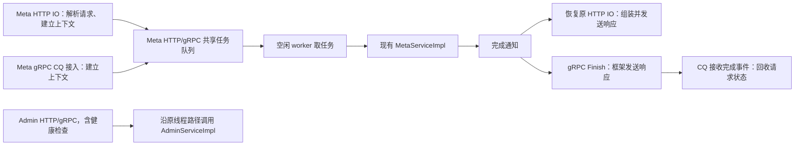

# HTTP/gRPC 业务线程池设计

## 1. 方案概览

**在 Meta 的 HTTP/gRPC 接入层与现有 MetaServiceImpl 之间，加一个共享业务池。接入层异步等待，空闲 worker 从同一个队列取请求。Admin 与健康检查整体保留原执行路径。**

这解决 Meta 请求的两个直接问题：HTTP 慢业务不再占住负责多个连接的 IO 线程；业务任务能交给空闲 worker，而不是跟随连接固定分配。Meta 业务并发由 worker 数控制，HTTP IO 线程数继续独立配置。



设计约束：

- 改动集中在 `service` 接入、装配和配置，以及直接相关的测试、文档。
- ServiceImpl 及其下游保持同步接口；不改业务算法、协议、SDK 或领域 executor。
- 一个共享队列足以实现动态调度。本次不增加按业务分池、优先级、work stealing 或通用调度框架。
- 现有路由、请求/响应结构、错误映射、日志、指标和 Leader 准入规则尽量保持。队列默认不设显式长度上限，不因队列满拒绝请求；显式配置正数上限时的拒绝行为单独说明。
- 发现原有问题时单独记录，后续独立 PR 处理；由本次异步边界直接引入的生命周期问题必须在本 PR 解决。

## 2. 范围与兼容性

| 入口/组件 | 本次处理 |
|---|---|
| Meta HTTP API | 现有解析和上下文准备后，异步投递 MetaServiceImpl 调用 |
| `/api/reportEvent` | 覆盖 Arena 和专用 JSON parser 路径，保留现有解析策略 |
| Meta unary gRPC | 使用当前依赖已有的 AsyncService + 显式 CQ 轮询，与 Meta HTTP 共享同一业务池；选型背景见第 5.2 节 |
| Admin HTTP/gRPC 全部接口、`/api/healthy` | 整体保留原执行路径，不注入业务池，不新增排队或提交拒绝 |
| `/metrics`、可选 Debug HTTP/gRPC | 保持原执行方式；不因复用模板而顺手迁移 |
| 当前 main 的 Optimizer 事件订阅服务 | 保持原同步/流式接口和注册方式，不将长连接订阅放入业务队列 |
| 迁移、回收、Meta 大查询 executor | 保持原职责、配置和调用关系 |

兼容性目标：

| 项目 | 保持的行为 / 必须说明的差异 |
|---|---|
| 协议 | 不改 `.proto`、字段、JSON 表示、路由、端口或客户端调用方式 |
| 普通 HTTP | 业务结果继续使用 HTTP 200 + 原 protobuf JSON；解析失败仍为 400，现有序列化失败处理不变 |
| gRPC | 正常业务成功/失败继续使用 gRPC OK + 原响应 header；不把业务错误改成 transport error |
| 健康检查 | 健康时仍为 200 + `{"status":"OK"}`；不健康时仍为 503 + 原错误响应 |
| 请求关联 | 同一个 RequestContext 跨交接使用，保留 trace_id、request_id、client_ip；不在线程切换时重建 |
| Instance 隔离 | 仍由原 ServiceImpl/manager 按 instance_id 处理，不新增跨 Instance 复用 |
| 顺序 | 不改变同一 HTTP 连接的框架处理顺序；不同连接/RPC 间不新增顺序保证 |
| 排队 | Meta 新增显式业务队列，调度顺序和延迟分布会变化；Meta HTTP 与 gRPC 共享业务容量 |
| 过载 | 默认继续排队，不因队列满拒绝，在这一点上与原来行为基本等价；显式配置正数上限后才启用队列满拒绝，详见第 4 节 |
| 停机 | 默认丢弃尚在队列中的 Meta 任务，可配置为继续执行；已被 worker 领取的任务均继续执行。被丢弃及关闭提交后新提交的请求，尚能回包时返回 SERVICE_NOT_READY；两种模式都要等待协议收尾，详见第 2.2、6.2 节 |

### 2.1 本次范围决策：只迁移 Meta，Admin 与健康检查保留原路径

2026-10-23 确认：原需求覆盖 Meta/Admin，本 PR 收窄为仅迁移 Meta HTTP/gRPC。这样可以先解决 Meta 请求的 IO 阻塞与业务调度问题，同时避免 Meta 积压给管理操作和探活新增一层共享队列等待。按现有 Service 边界整体处理，保持实现轻量。

| 服务边界 | 执行方式 | 是否受新队列容量与关闭提交影响 |
|---|---|---|
| Meta HTTP/gRPC，包括 `GetClusterInfo` 和 `ReportEvent` | 接入侧准备请求 → 共享业务池 → MetaServiceImpl → 协议完成 | 是；`Full` / `Closed` 仅作用于这些提交 |
| Admin HTTP 全部接口，包括 `/api/checkHealth`、管理查询和 `LeaderDemote` | Admin HTTP IO 仍同步调用 AdminServiceImpl | 否；保留原有线程和业务准入规则 |
| Admin gRPC 全部接口 | 保留生成的同步 `Service` 和同步业务执行；同端口的网络轮询变化见第 5.2.3 节 | 否；仍按原配置与 Meta 共用 gRPC server 或使用独立 server |
| `/api/healthy` | 保留 Admin 的手写同步 handler、CheckHealth 调用及原响应分支 | 否；不因 Meta 队列 `Full` / `Closed` 新增 503 |

实现上，`Server` 只向 Meta adapter 注入 executor；`CoroHttpService` 为 Meta 增加异步返回分支，同时保留 Admin 和 Debug 使用的同步分支。Admin adapter 和健康检查不改为协程业务桥接，也不在各方法中零散添加“绕过队列”判断。本次不新增 Admin 专用池、优先级或控制通道。

这一取舍的边界：

- Admin HTTP 原本就有独立于 Meta 的 IO 池，继续保留；Admin 内部的慢调用仍可能阻塞同一 IO 上的健康检查，这是原路径的限制。
- Admin 与 Meta 仍共享进程 CPU、锁、后端等资源，部分部署还共用 gRPC server；新增显式 CQ 时，同端口网络推进也会依赖该 CQ。因此这里只避免新增 Meta 业务队列等待，不保证过载时管理接口始终快速响应，详见第 5.2.3 节。
- `MetaService::GetClusterInfo` 仍属于 Meta，进入共享池；不要将它与 Admin 的 `GetManagerClusterInfo` 混为一谈，也不承诺所有集群查询、Leader 发现请求都绕过队列。
- Admin 保持原调用及返回规则；全局停机仍需等待 Meta 新增队列收尾，可能影响 Admin 所在 server 的最终关闭时刻，详见第 6.2 节。

Admin 的业务解耦不在本 PR 内。后续如有必要，可独立评估复用调度组件，不在本次预先实现多池治理。

### 2.2 兼容性复核：仍会变化的行为

队列默认不限长只消除了默认 `Full` 拒绝，不能据此宣称整体行为等价。以下是本次线程模型变化直接引入或放大的差异，不是顺带修复的既有问题：

| 项目 | 现有行为 | 现方案的变化及处理 |
|---|---|---|
| **Meta 两种协议入口的容量隔离** | Meta HTTP 与 gRPC 使用不同执行线程；Admin HTTP 有独立 IO 池，Admin gRPC 可单独配置 server | Meta HTTP/gRPC 共用 FIFO 池后会相互占用业务容量，Meta 的 GetClusterInfo 也需排队。Admin 与健康检查按第 2.1 节保留原路径，不加入该队列；不宣称整个进程资源完全隔离 |
| **业务并发与旧配置的实际作用** | HTTP 业务并发受各自 IO 线程数影响，gRPC 同步服务在框架配额内按需增加执行线程 | `worker_thread_num` 成为 Meta 跨协议的共享上限，既可能收紧原并发，也可能增加单入口对后端的压力。已有 IO 配置仍控制 IO 池，但不再直接控制 Meta 业务并发；Admin 的原配置作用保留。`2C` 不是旧容量的等价换算 |
| **客户端超时/断开后的晚到执行** | 已开始的同步业务不会因客户端停止等待而自动取消；一些请求仍未被读取或调度 | 新 IO 可提前接收更多请求，客户端在业务尚未开始时超时，排队写请求仍可能随后执行。“超时不保证未写入”的原则不变，但窗口和出现频率可能增加。不因客户端超时自动取消任务；停机时的丢弃策略单独配置，需实测，不额外引入重试或幂等改造 |
| **停机时的新返回与执行范围** | 先 Shutdown gRPC，再 Stop HTTP；前一阶段 HTTP 仍可处理请求，未处理的连接数据可能随关闭丢弃 | 先 CloseAdmission 会让尚可回包的新 Meta 请求收到 SERVICE_NOT_READY，即使容量为 `0` 也成立。默认 `discard_pending` 使仍在队列中的任务不再执行业务，按同样错误形式收尾；选择 `drain` 才继续执行这些任务，可能增加停机时长和写入范围。两种模式都等待已领取任务及协议收尾，Admin/healthy 不新增这条拒绝路径 |
| **指标、访问日志和 trace 的时间范围** | RequestContext 创建前等待 IO 调度的时间未计入基于该上下文的耗时 | 新队列位于 Context 创建之后，访问日志、部分事件指标、根 trace span 会包含排队时间；ServiceCallGuard 的业务范围和子业务 span 仍不包含。字段不改，但数值不能直接解释为业务变慢 |
| **请求执行时看到的状态与顺序** | 不同连接/RPC 之间本就没有全局顺序保证，但同 IO 的同步业务实际串行 | worker 会并行执行来自同 IO 的不同连接，且排队可跨越 Leader 切换、Instance 删除/重建。仍在真正进入 ServiceImpl 时检查角色和业务状态；不能把 FIFO 当作全局业务完成顺序或入队时状态快照 |
| **gRPC collector 准备与错误优先级** | 原同步入口在业务前查询 collector，初版调度实现也在 CQ 提交前查询 | collector 查找可能等待 Instance 生命周期锁，现移入 worker，避免独占 CQ 停顿。`Full` / `Closed` / 停机丢弃直接返回 SERVICE_NOT_READY，优先于尚未执行的 Instance 检查；已接受请求按 worker 准备时的 Instance 状态处理 |
| **积压和资源占用** | 部分等待发生在网络/框架侧，业务并发分散在多个入口 | 更多已解析请求留在应用队列；另外还保留原 IO 池并新增 worker。需对照启动内存、总线程数和持续过载内存，而不只比较吞吐 |

以上新增排队、计时和执行时状态差异针对 Meta 迁移路径。Admin 与健康检查的范围取舍已按第 2.1 节确定，不再保留统一入池的备选实现。

需要保持并通过测试确认的现有行为：普通 HTTP/gRPC 错误与异常返回、同一 HTTP 连接的原有串行处理顺序、Instance 隔离、Leader 执行时准入、现有客户端重试/超时配置。当前 HTTP 未启用 cinatra 连接空闲超时，本次保持该配置，不顺带增加框架 timer 或排队 deadline。

gRPC 异步适配见第 5.2 节。第 6.2 节的主线程停机协调和 CQ 收尾同样属于本次迁移直接触及的生命周期要求，不能用“原有问题另开 PR”跳过。

## 3. 最小组件与接口

### 3.1 ServiceRequestExecutor

在 `service/` 增加一个只用于服务请求的 `ServiceRequestExecutor`，由 `Server` 创建、仅注入 Meta HTTP/gRPC adapter，并管理生命周期。本次该池只承载 Meta 请求，Admin 不持有 executor。

实现采用固定数量的 `std::thread`、一个 FIFO 队列、mutex 和 condition_variable。worker 取出任务后立即释放队列锁，再调用业务。任务不携带固定 worker 编号；空闲 worker 可以取下一个任务。FIFO 指取出顺序，不承诺多 worker 的完成顺序。

最小能力：

```text
TrySubmit(task) -> Accepted / Full / Closed
CloseAdmission(shutdown_mode)    // 原子关闭提交，按策略处理待执行队列，幂等
Drain()                          // 等执行或丢弃后的交接全部收尾
Join()                           // 退出并回收 worker
```

`TrySubmit` 只短暂持有队列锁，不等待队列出现空位；失败时也不在调用线程直接执行业务。`Accepted` 与 `CloseAdmission` 在同一同步边界内判定，关闭后不能再漏入新任务。

`worker_queue_capacity = 0` 表示不设显式队列长度上限，不触发 `Full`；正数表示最多允许等待的任务数，达到上限后返回 `Full`。`Closed` 与容量配置无关，停机关闭提交后两种模式都不再接受新任务。

任务仅增加两个互斥回调：`run` 执行业务并完成请求，`on_discard` 在停机丢弃时只完成请求、不调用业务。成功提交后恰好执行其中一个；提交失败则仍由入口完成。`CloseAdmission` 与 worker 取任务使用同一队列锁：`discard_pending` 模式下关闭提交并移出剩余队列，释放锁后由停机协调线程逐项调用 `on_discard`；`drain` 模式保留队列供 worker 执行。回调不在锁内运行，不等待 IO 恢复。重复关闭不重复完成请求，详见第 6.2 节。

`Drain` 的返回条件是：队列为空、执行中任务为零、丢弃回调收尾中任务为零、已接受 Meta HTTP 请求的完成凭据为零。它不表示一定执行业务；丢弃通知也计入收尾。gRPC 的 Finish 仅发起异步完成，业务池 Drain 不覆盖其后续 CQ 事件；Server 还需等待 Meta gRPC adapter 的 CallState/事件回收，包含未入池的接收槽和直接拒绝请求。必须由独立于业务 worker、HTTP IO 和 CQ 线程的停机协调线程调用，完整顺序见第 6.2 节。

任务回调封装原 ServiceImpl 调用及协议侧完成通知；丢弃时的错误响应也由 adapter 提供的回调填写。池本身不了解具体业务 API、Leader、HTTP 状态码或 protobuf。HTTP Promise、gRPC CallState/response writer 和 CQ 留在各自 adapter，避免把传输依赖加到调度组件中。不增加通用取消 token 或运行中任务中断机制。

不复用 QueryExecutor：它有调用方参与执行等领域策略，不能让 HTTP IO 因队列满回退为同步执行业务。不抽取或重构现有线程池实现。

### 3.2 配置

沿用 `ServerConfig` 的现有配置方式，新增三个启动参数，不做动态伸缩：

| 参数 | 默认值 | 含义 |
|---|---|---|
| `kvcm.service.worker_thread_num` | `0`，自动取 `2 × max(1, hardware_concurrency())` | Meta HTTP/gRPC 共享的进程级业务 worker 数，不限制 Admin 并发；正数显式指定，负数非法 |
| `kvcm.service.worker_queue_capacity` | `0` | Meta 最大等待队列长度，不含正在执行的任务；`0` 表示不设上限、不因队列满拒绝，正数启用上限，负数非法 |
| `kvcm.service.worker_shutdown_mode` | `discard_pending` | 停机丢弃仍在队列中的 Meta 任务；可设为 `drain` 继续执行队列。两种模式均等待已领取任务及协议收尾；其他值非法 |
| 已有 `kvcm.service.io_thread_num` | 保持当前规则 | 继续控制各 HTTP server 的 IO 池，不改含义、不自动调小 |

2026-10-23 参数讨论修订：令 `C = max(1, hardware_concurrency())`，把业务 worker 的初始建议由 `C` 调整为 `2C`。业务线程会在同步 Redis 调用、连接池和锁等位置等待，CPU 数不能直接代表合适的业务并发数。`2C` 是初始默认值，尚未用真实阻塞后端对照 `C / 2C / 4C` 进行容量压测，不保证足够，也不据此宣称吞吐收益。

现有 `kvcm.service.io_thread_num` 默认配置值为 `0`，启动时取 `hardware_concurrency()`；Meta/Admin 分别有自己的 HTTP IO 池，另有 gRPC 线程。新池只接管原 Meta HTTP 与 Meta gRPC 的业务执行，Admin 原有执行容量继续保留，不计入新 worker 上限。共享池设为 `C` 可能收紧原 Meta 业务并发预算，设为 `2C` 也不等于完整保留旧预算。新 worker 自动值独立于 HTTP 配置，不顺带改变 IO 池大小；压测需记录改造前后的总线程数和实际业务并发。

线程增多是否有效取决于真实等待和下游余量。内存命中的查询不一定访问 Redis；客户端直接向存储后端 Load/Save KVCache 的时间也不能算作 KVCM worker 的等待时间。同步 MetaRedisBackend 的连接池默认每实例最多 16 个连接，增加 worker 后可能转而等待连接；本次不连带修改 Redis/Pace 的连接池或容量配置。

`hardware_concurrency()` 是硬件线程数的提示值，不是部署业务容量的测量结果。已知容器 CPU 配额或业务并发预算时优先显式配置；本次不增加 CPU 配额识别和自适应调参机制。

默认值 `0` 用于保持“不因业务繁忙而主动返回队列满错误”的行为；它不表示零容量，也不表示无限内存。配置正数时按请求数限制等待队列，**不是整个进程的内存硬上限**。已读入报文、框架缓冲和大请求仍占内存；本次不扩展为按字节配额、连接数治理或全局流量控制系统。

停机模式与队列容量独立：容量为 `0` 或正数都默认采用 `discard_pending`。该默认值按 2026-10-23 讨论确定，目的是避免停机时继续执行整批积压业务；它不改变正常运行时的排队策略，也不应用于 Leader 降级或客户端超时。

Meta gRPC 使用一个显式 CQ 和一个固定轮询线程，不新增 CQ 配置项。该线程只接收、分发和处理完成事件，不计入业务 worker 数；其接入开销与吞吐需结合实际负载验证，不能把这个初始规模预先视为足够。

2026-11-04 rebase 补充：保留 main 的 `ConfigureGrpcServer`、`grpc_max_threads` 和 `grpc_memory_quota_bytes`。线程配额继续约束 Admin/Debug/Optimizer 等同步 gRPC 处理线程，不约束自建的 Meta worker 和 CQ 轮询线程；Meta 业务并发由 `worker_thread_num` 控制。内存配额仍由 gRPC 处理，不把它解释为业务等待队列或整个进程的内存上限。

## 4. 排队策略与请求完成

**默认 `worker_queue_capacity = 0`，不设置显式等待队列长度上限，不因队列满拒绝请求。** worker 全忙时，新任务继续排队等待执行。从“不主动因业务繁忙返回队列满错误”的角度，与原来的等待行为基本等价；线程池、异步交接与停机设计保持不变。

这一等价性不覆盖资源占用和延迟：原来 IO 线程被业务占住时，部分请求还等待网络读取或框架调度；拆分后 IO 可以继续读取、解析，更多请求会携带 protobuf、RequestContext 和协程状态进入业务队列。默认模式可能更快积压应用内存，仍可能发生客户端超时或资源耗尽。验证中需要观察持续过载时的队列长度、等待时间和内存变化，不承诺无限接收。

**仅在显式配置 `worker_queue_capacity > 0` 时启用队列满拒绝。** 此时有界队列用于限制等待任务数量，满时快速返回，复用现有 Meta `SERVICE_NOT_READY`，不新增协议枚举。以下排队及拒绝策略只适用于 Meta；停机的 `Closed` 拒绝在两种容量模式下都生效：

| 场景 | 返回 |
|---|---|
| 默认容量 `0`，worker 全忙 | 继续排队，不返回队列满错误 |
| 正数容量已满，Meta HTTP 返回 `Full` | HTTP 200，原响应 `header.status.code = SERVICE_NOT_READY` |
| 正数容量已满，Meta gRPC 返回 `Full` | gRPC OK，原响应 `header.status.code = SERVICE_NOT_READY` |
| 停机关闭提交后到达的 Meta 请求 | 尚能返回响应时使用同样的 SERVICE_NOT_READY 形式；随后由框架关闭接入 |
| 停机采用 `discard_pending`，已接收但仍在队列中的 Meta 任务 | 不进入 ServiceImpl；HTTP 200 / gRPC OK + 原响应 `header.status.code = SERVICE_NOT_READY`，消息为 `service is stopping`；仍须完成协议收尾 |
| Admin HTTP/gRPC、`/api/healthy` | 不提交到业务池，继续原执行和返回规则，不产生上述 `Full` / `Closed` 拒绝 |

`Full` 与 `Closed` 的错误消息分别为 `service request queue is full` 和 `service is stopping`。对已建立上下文的 Meta 请求填入同一个 request_id。协议解析失败仍先发生。HTTP 的未注册 Instance 检查保留在提交前；gRPC 为避免阻塞唯一 CQ，将 collector/Instance 检查移到 worker，因此提交失败及停机丢弃优先返回 SERVICE_NOT_READY，不能再承诺未注册 Instance 总是优先返回。

**`Closed` 是停机期间的特殊情况。** 正常运行时，容量为 `0` 的 Meta 队列继续接收并排队，不因业务繁忙触发 `Full` 或 `Closed`。开始停机并调用 `CloseAdmission(shutdown_mode)` 后，后续提交的 Meta 请求才会被拒绝；在协议入口尚能回包的窗口返回 SERVICE_NOT_READY（`service is stopping`）。默认丢弃仍在队列中的任务并完成错误响应；配置 `drain` 时才继续执行这些任务。已被 worker 领取的任务始终继续执行并收尾，随后框架关闭接入。Admin 与健康检查不受这个提交开关影响。

停机丢弃的任务此前已返回 `Accepted`，与入口提交失败的 `Closed` 是两条不同的内部路径，只复用相同的外部错误格式；丢弃时保留原 request_id，不产生写入副作用，也不伪造 ServiceCallGuard 业务执行。不能直接销毁任务而不通知等待方。

正数容量下的队列满拒绝是显式启用的新增外部行为，只复用了既有业务错误返回格式。另需保持以下边界：

- 当前 C++ SDK 会把 SERVICE_NOT_READY 映射为 `ER_SERVICE_INTERNAL_ERROR`。本 PR 保留该映射，不承诺自动退避或重试。
- 健康检查和 Admin 请求不占用新业务池容量；Meta 队列满或关闭提交不直接改变其返回。原 Admin IO 阻塞及共享资源竞争仍可能影响探活，边界见第 2.1 节。
- 拒绝任务不进入 ServiceImpl，不产生写入副作用，也不伪造一次 ServiceCallGuard 业务执行。使用少量提交拒绝计数/限频日志观察这一新路径。
- 不新增排队超时、自动重试或客户端断开后的业务取消。客户端超时不代表写入未发生，这一原则与现有同步业务一致；新队列扩大了“业务尚未开始、客户端已经停止等待”的窗口，不能据此声称取消/断连的整体行为等价。

每个已接收请求只有一个发起完成的路径：worker 执行，或停机协调线程执行丢弃回调。两者均由 adapter 通过 HTTP Promise 或 gRPC response writer 发起完成；入队失败则由入口处理，池不会再拿到该任务。gRPC 还要等 Finish 完成事件后回收请求状态。业务及丢弃收尾中的异常也必须走完成路径，不能让请求永久等待。

## 5. 两种传输适配

### 5.1 HTTP：协程挂起，回原 IO 线程收尾

主要修改 [CoroHttpService](../../kv_cache_manager/service/http_service/coro_http_service.h) 和 [MetaServiceHttp](../../kv_cache_manager/service/http_service/meta_service_http.cc)。[AdminServiceHttp](../../kv_cache_manager/service/http_service/admin_service_http.cc) 保留原调用路径：

1. `GetHandler` / `GetArenaHandler` 按原方式解析请求，保持 protobuf/Arena 存放在请求协程内。
2. Meta 的适配方法改为返回 `Lazy<HttpDispatchResult>`。保留原 collector 查找、提前返回和 RequestContext 创建顺序，在原 IO 上提取 client_ip。
3. 仅将 `ServiceImpl` 调用、其现有 guard 收尾和 `TakeReusableResponseJson()` 放入 worker 任务。
4. handler `co_await` 一个 `async_simple::Future<HttpDispatchResult>`。等待期间不占用 IO 线程。
5. worker 完成后，由 Future 的 executor 恢复机制回到原 IO；按原方式复用 JSON 或进行回退序列化，设置 HTTP 响应。

`HttpDispatchResult` 只包含可选 JSON、`exception_ptr` 和一个轻量完成凭据：已接受任务对应的凭据在最外层 HTTP handler 收尾时释放，供停机等待。它不是通用请求状态机。提前拒绝不取得已接受任务凭据；停机丢弃已接收任务时则必须把已有凭据随错误结果交回原 IO，仍由最外层 handler 释放。

当前版本的 `FutureAwaiter` 会保存 Lazy 的 executor，并通过 `checkout/checkin` 恢复；IO executor 的 `checkin` 使用 `asio::post`。因此选择 Promise/Future 桥接，不假设任意 `coro_io::post` 都会自动回原 IO。依据见 [固定版本 FutureAwaiter](https://github.com/alibaba/yalantinglibs/blob/0.5.5/include/ylt/thirdparty/async_simple/coro/FutureAwaiter.h) 和 [IO executor](https://github.com/alibaba/yalantinglibs/blob/0.5.5/include/ylt/coro_io/io_context_pool.hpp)。

生命周期规则：

- worker 不访问 HTTP request/response/connection，只访问 protobuf、RequestContext 和 ServiceImpl。
- 上述对象由未结束的请求协程保留；worker 完成前不销毁、不在 IO 上并发读取响应。
- ReportEvent 保留原 Arena 和 parser。parser 已把字符串写入 protobuf；不让 worker 读取连接 body，也不额外复制整份 HTTP 报文。
- RequestContext 的延迟 JSON 缓存按 IO → worker → IO 顺序交接，不跨线程同时读写，无需为其增加锁。
- 使用非 void 的 Future 结果承载完成及异常；worker 捕获异常后把 `exception_ptr` 和凭据一起交回 IO。最外层 handler 先持有凭据，再重新抛出异常，直到 handler 退出才释放。不能直接用 `Promise::setException` 导致凭据在 worker 侧提前销毁。

当前 cinatra 的连接协程持有连接对象，并等待 handler 后才回写、清理请求和处理后续请求；参见 [固定版本 server](https://github.com/alibaba/yalantinglibs/blob/0.5.5/include/ylt/standalone/cinatra/coro_http_server.hpp) 和 [connection](https://github.com/alibaba/yalantinglibs/blob/0.5.5/include/ylt/standalone/cinatra/coro_http_connection.hpp)。不修改第三方源码。

现有 [router 异常分支](https://github.com/alibaba/yalantinglibs/blob/0.5.5/include/ylt/standalone/cinatra/coro_http_router.hpp#L203) 将 handler 异常映射为 HTTP 503。回原 IO 重抛后继续走该路径，不统一改成 HTTP 500 或新增 protobuf 错误。

适配边界：

- 公共 collector 宏有普通 `return`，HTTP 协程路径需使用对应的 `co_return` 形式；局部适配，不重写整个宏体系。
- `/api/healthy` 保留手写 handler 同步调用 CheckHealth，不新增 Promise 或完成凭据。公共模板保留 Admin 所用的同步 `CachedJsonResponse` 分支，以及 Debug 所用的同步 `void` 分支；仅 Meta 使用新增异步分支。

### 5.2 gRPC：AsyncService + 显式 CQ 轮询

#### 5.2.1 背景：为什么需要异步接口，为什么撤回 callback 选型

原同步 gRPC handler 要等业务做完才返回。若把业务提交到新池后仍在入口线程阻塞等待，就没有释放接入线程；若直接返回，框架又会把 RPC 当作已经完成。因此这里需要“先接收并交出任务，业务结束后再完成 RPC”的异步接口。客户端仍按原协议调用，不需要改为异步客户端。

[依赖声明](../../open_source/deps/git.bzl) 固定 gRPC commit 为 `109c570727c3089fef655edcdd0dd02cc5958010`，版本是 1.19.1。该版本已有 `ExperimentalCallbackService` 和 `AsyncService`，没有现代 `CallbackService` / `ServerUnaryReactor`。最初选择 callback，是因为入口可提交任务后返回，worker 再通过 controller 通知完成，应用侧代码较少。

但这个设计还依赖一个前提：**框架必须持续推进真实 TCP 网络事件，并在有效的执行上下文中调用 callback。** 接口存在、继承签名可编译、允许与同步服务混合注册，都不能证明这一前提成立。评审核查发现该旧版本还有启动、停机和错误请求路径的问题，因此撤回“callback 已确定为实现路线”的结论。

**本方案使用 AsyncService + 显式 CompletionQueue（CQ，完成事件队列）轮询。** 我们明确安排 CQ 接入线程，接收“请求到达”和“响应完成”等事件，业务仍交给同一个 Meta worker 池。底层网络和协议仍由 gRPC 处理，CQ 不成为另一个业务池。不升级依赖，不修补旧 callback 分支。

#### 5.2.2 实现：接收、业务和完成事件分开

Meta adapter 使用生成的 `MetaService::AsyncService`，不再实现 callback controller 方法。`Server` 注册该服务并调用 `AddCompletionQueue()` 创建一个显式 CQ，由一个固定接入线程持续 `Next(tag, ok)`。Admin 保留同步 Service，Debug/Optimizer 保留原注册接口；不修改 proto 生成选项。接口形态参考 [固定版本官方异步示例](https://github.com/grpc/grpc/blob/109c570727c3089fef655edcdd0dd02cc5958010/examples/cpp/helloworld/greeter_async_server.cc)，其简化示例不替代本稿的异常、取消与停机处理。

```text
CQ 线程收到 Request 完成事件（新请求到达）
  → 补挂下一个接收槽，建立不含 collector 的上下文，TrySubmit
  → 立即继续 Next，接收其他事件
worker 查询并绑定 collector，检查准备结果后执行业务
  → writer.Finish(response, status, finish_tag)，异步交给 gRPC 发送
CQ 线程收到 Finish 完成事件
  → 释放事件持有的请求状态
```

最小职责划分：

1. **启动与接收**：创建 CQ 后先启动轮询线程，再 BuildAndStart；成功后才为每个 Meta unary 方法预挂一个 `RequestXxx` 接收槽，避免已匹配请求存在时没有轮询线程。每次接收成功，若未进入停止补挂状态，先补挂下一个槽，再建立 RequestContext，记录 request_id、开始时间、根 trace 和 peer/client_ip；collector 留待 worker 查询。接收槽不是业务并发上限，不为每个请求创建线程。
2. **任务分发**：CQ 线程只做上述轻量初始化、快速提交和完成事件处理，不获取 collector 或 Instance 业务锁，不阻塞等待 worker。collector 查找、ReportEvent 附加 collector 准备、ServiceImpl、guard、日志和指标都在业务 worker；提交失败由 CQ 接入路径填写错误并发起 Finish，停机丢弃由 `on_discard` 发起 Finish。
3. **请求所有权**：adapter 的轻量 `CallState` 持有 ServerContext、protobuf 请求/响应、ServerAsyncResponseWriter 和 RequestContext。独立的小接收/完成 tag 与已接收的任务分别持有其生命周期引用；在提交异步操作前建立引用，避免 tag 作为 CallState 成员强引用自身形成环。Finish 完成事件可能早于 worker 返回，须等事件引用与任务引用均释放后才能销毁。worker 发起 Finish 后不再读写请求态；**Finish 返回不等于对象可以释放**。
4. **事件分类**：接收 tag 的 `ok=false` 表示该接收槽没有取得请求，只回收，不调用业务、不发送 Finish；Finish tag 的 `ok=false` 也代表该操作已终结，仍必须释放状态，不能忽略或断言 `ok`。`Next` 返回 false 表示 CQ 已关闭且事件排空，此时轮询线程才退出。初版只管理接收和完成两类事件，不抽取通用 RPC 状态机。
5. **恰好一次完成**：准备/提交失败、业务成功或失败、业务异常、停机丢弃均走各自唯一完成路径。正常业务错误仍为 protobuf header + gRPC OK；C++ 异常保持原 `UNKNOWN` 与 `Unexpected error in RPC handling`。collector 宏的提前返回局部改为完成当前调用，不重构整个宏体系。CQ 循环必须隔离单请求异常，不能因一个请求退出而停止整个 server 的接入。

生命周期依据：[ServerAsyncResponseWriter::Finish](https://github.com/grpc/grpc/blob/109c570727c3089fef655edcdd0dd02cc5958010/include/grpcpp/impl/codegen/async_unary_call.h#L218)、[CQ 关闭与排空约定](https://github.com/grpc/grpc/blob/109c570727c3089fef655edcdd0dd02cc5958010/include/grpcpp/impl/codegen/completion_queue.h#L220)、[原同步异常映射](https://github.com/grpc/grpc/blob/109c570727c3089fef655edcdd0dd02cc5958010/include/grpcpp/impl/codegen/method_handler_impl.h#L39)。

#### 5.2.3 兼容性边界

- **Admin 共用端口**：Admin 业务仍在同步框架执行，不进入 Meta 池；但该版本 builder 在存在显式 polling CQ 时会将同 server 的同步 CQ 设为 NON_POLLING，网络推进依赖显式 CQ。因此不能承诺所有内部调度细节不变。CQ 线程不得执行业务或等待业务队列；需验证 Meta 忙碌时 Admin 仍可接入。独立 Admin server 不添加该 CQ，保留原 builder 配置。依据见 [混合 server 的 CQ 选择](https://github.com/grpc/grpc/blob/109c570727c3089fef655edcdd0dd02cc5958010/src/cpp/server/server_builder.cc#L253)。
- **错误 protobuf**：typed AsyncService 会在框架内部以 `INTERNAL / Unable to parse request` 取消解析失败的调用，并重新挂接收槽，不把该事件交给应用。与原同步错误消息可能存在差异，必须对照记录状态码和消息，不宣称全部 transport 错误文本逐字不变；若有外部依赖则在选型验证阶段解决或重新评估。内部重挂也必须被停机时的 CallState 存活等待覆盖，不能只观察业务队列。依据见 [PayloadAsyncRequest](https://github.com/grpc/grpc/blob/109c570727c3089fef655edcdd0dd02cc5958010/include/grpcpp/impl/codegen/server_interface.h#L249)。
- **gRPC 响应指标**：保留 main 的响应 interceptor，正常 Meta 响应、业务拒绝（transport OK）及 UNKNOWN 均走 `PRE_SEND_STATUS` 统计。固定版本 typed AsyncService 的 protobuf 解析失败会在建立 interceptor 前由 core 取消，未进入该上报路径；因此 `grpc.response_counter` 不覆盖这类异步解析失败，不能当作全部 transport 错误的完整计数。本次不为补齐它改成自定义解码或修改第三方库。
- **取消/deadline**：不因客户端取消自动终止已接收业务，不新增运行中取消策略；原接入前取消、入队后取消和执行中取消分别对照。初版不新增 AsyncNotifyWhenDone，也不在不满足异步 API 前提时读取 IsCancelled；对象按接收/Finish 事件与任务引用收尾。默认停机丢弃仍按第 6.2 节处理。

### 5.3 日志、指标与序列化位置

保留 [ServiceCallGuard](../../kv_cache_manager/service/util/service_call_guard.cc) 中已有的响应 JSON materialize、计数回调、指标和访问日志。Meta 的这些操作随 ServiceImpl 在 worker 执行，HTTP 恢复后复用同一份 JSON；Admin 继续在原执行路径记录。需求中的“接入层负责响应”落实为协议响应组装及回写；不为移动全部 JSON 序列化而重构日志体系。

正常业务保持原日志次数、字段和指标标签。以下对计时的影响仅适用于 Meta：

- ServiceCallGuard 的业务执行范围仍从进入业务开始，不计队列等待。
- RequestContext 在接入侧建立，基于 `request_begin_time_us` 的请求总耗时自然包含新增排队时间，例如访问日志和部分事件请求耗时。不能把它们解释为纯业务执行时间，也不能宣称数值口径没有新增阶段。
- RequestContext 构造时也创建根 SpanTracer，因此返回给客户端的根 `tracer_result.span_time_us` 会包含新增排队时间，业务方法内部创建的子 span 仍只覆盖执行阶段。以前发生在 Context 创建之前的接入等待不会进入这些数值。
- gRPC 的 Context 改在 collector 查询前建立，因此总耗时和根 trace 还包括 worker 内的 collector 准备时间；HTTP 保留原准备顺序。

最小观测只覆盖新队列的长度、执行中任务数、提交拒绝数和停机丢弃数，复用现有指标设施；丢弃任务不计为已执行业务，排队时间与完成时序可在定向测试中记录。已有共享指标竞争或日志性能问题不并入本次修复。

四项指标分别为 `service.request_queue_length`、`service.request_running`（采样 gauge）和 `service.request_rejected`、`service.request_discarded`（累计 counter）。KMonitor 不会自动遍历 registry，须显式注册并周期上报；累计 counter 沿用该后端现有 GAUGE 约定，不能当作 QPS 增量重复累加。

停机时先停止并 join 定时上报线程，再采集最终快照、补齐尚未采样的计数并调用 reporter 的 `ReportInterval()`，同时记录含 rejected/discarded 总数的最终日志。周期和最终采样共用增量基线，避免重复计数。该动作保证将最终值交给 reporter；不新增后端 flush/送达保证，HTTP 停止后也不保证 Prometheus 能完成最后一次抓取，最终日志用于保留本地记录。

## 6. Leader 切换与停机

### 6.1 Leader 仍在真正进入业务时判断

沿用 [ServiceImplBase](../../kv_cache_manager/service/service_impl_base.cc) 的准入与活跃计数：

- 排队任务尚未进入 ServiceImpl，不提前算 active leader-only 请求。
- worker 调用原 ServiceImpl 时，仍由原 guard 检查当前角色并计数。
- 降级继续执行 `DisableLeaderOnlyRequests → 等正在执行的 leader-only 请求 → Cleanup`。
- follower 阶段取出的 leader-only 请求按原路径返回 SERVER_NOT_LEADER；非 leader-only 接口仍按原规则执行。
- 若排队期间经历降级和重新当选，任务真正执行时已经 Recover 并开放服务，则按当时状态执行。现有协议没有“请求绑定 Leader 任期”的约定，本次不新增 epoch 或跨任期取消。

业务池在 follower 状态继续存在。不要在降级时清空整个队列、停止池或等待所有池任务。`LeaderDemote` 仍从 Admin 原路径执行，不调用 Meta 池的 Drain；降级继续按原规则等待正在执行的 leader-only 请求，其中也包括 Admin 的相关请求。

同理，入队时不缓存 Leader 判定、Instance 业务对象或其他可替代执行时检查的状态。已经取得的 metrics collector 由 RequestContext 的 shared_ptr 保持存活，但这不保证它的标签与删除/重建后的 Instance 一致。排队期间发生 Instance 删除/重建的业务错误与指标归属需定向验证；不把这种可能被放大的既有竞争窗口直接认定为新 UAF，也不借此重构指标生命周期。

### 6.2 停机等待到协议交接完成

#### 6.2.1 待执行队列策略：默认丢弃，可配置执行完

`kvcm.service.worker_shutdown_mode` 只决定进程停机时如何处理 Meta 待执行队列，不影响 Admin、健康检查、Leader 降级和客户端超时处理。

| 模式 | 停机时仍在队列中的任务 | 已被 worker 领取的任务 |
|---|---|---|
| `discard_pending`（默认） | 不再调用业务，按 SERVICE_NOT_READY 完成请求 | 继续执行并等待收尾 |
| `drain` | 继续由 worker 取出执行，直至全部收尾 | 继续执行并等待收尾 |

“丢弃”指不再执行业务，仍要完成对应 HTTP/gRPC 请求。采用以下最小实现，不引入运行中取消框架：

1. `CloseAdmission(mode)` 在同一队列锁下关闭提交；`discard_pending` 同时移出全部待执行任务，并登记丢弃收尾中的任务数。worker 从队列取任务并增加执行中计数也在此锁下完成，以此作为两条路径的唯一分界。
2. `discard_pending` 模式下，被移出的排队任务归停机协调线程完成；已被 worker 取走的任务归 worker 完成，即使后者还没实际进入 ServiceImpl，也不再丢弃。每个已接收任务只执行 `run` / `on_discard` 中的一条路径，不回滚已开始的写入。
3. 释放队列锁后，停机协调线程逐项调用 `on_discard`。adapter 填入原 request_id、SERVICE_NOT_READY 和 `service is stopping`，不调用 ServiceImpl 或创建 ServiceCallGuard；HTTP 通过 Promise 把错误结果及已有完成凭据交回原 IO，gRPC 调用 `writer.Finish(response, OK, finish_tag)` 并保留 CallState 至完成事件。回调不访问 HTTP connection、不等待 IO/CQ、不执行业务或整份 HTTP 响应序列化。
4. 每项完成通知后再减少丢弃收尾计数。HTTP 异常仍通过 `exception_ptr` 和凭据回到原 IO，gRPC 异常仍走原 UNKNOWN 完成规则；不能只记录异常而漏掉 Promise/Finish，也不能在通知前直接析构任务。大量丢弃任务仍需逐项收尾，不能宣称立即退出。

mode 来自启动配置，首次关闭决定策略；重复 CloseAdmission/Stop 不切换模式、不重复调用完成回调。`drain` 模式保留队列，继续由 worker 执行业务。两种模式都要等待业务池 Drain、HTTP 完成凭据及独立的 gRPC CallState/CQ 收尾，见下节。

#### 6.2.2 停机顺序与生命周期

Meta 新增异步等待后，**队列空或 worker 执行结束，不等于协议收尾已经完成。** HTTP Promise 可能只是把恢复任务放入 IO 队列；gRPC Finish 也只是发起异步发送，CQ 中仍有完成事件。提前停止 IO/CQ 会使请求无法收尾。Admin 不持有业务池的完成凭据，业务仍由原同步框架关闭路径收尾；共用 gRPC server 时也要保持显式 CQ 存活。

**必须补齐停机调用线程的前提。** 改造前 [CommandLine](../../kv_cache_manager/service/command_line.cc) 的信号处理直接调用 `Terminate → Server::Stop`，并没有现成的独立停机线程。退出信号若在业务 worker、HTTP IO 或 CQ 线程上处理，阻塞停机可能等待当前任务或线程自己完成，形成自等待。实现复用 `CommandLine::Run` 所在主线程作为停机协调方：信号处理仅写入 lock-free atomic 通知，主线程以 50 ms 间隔检查后执行 Stop/Wait；公开 Terminate 也仅发出通知。信号处理不能直接执行 Shutdown/Drain/Join，无需增加专用停机线程。必要的通知和线程交接属于本次生命周期改动，daemon、日志等无关信号处理重构另行处理。

`Server::Stop` 按以下依赖顺序调整：

1. `CloseAdmission(worker_shutdown_mode)` 关闭 Meta 业务提交，并停止应用侧补挂新的 gRPC 接收槽。补挂操作及 CallState 登记与该停止标志同步，避免停机漏记新状态。默认模式锁外逐项发出丢弃完成通知；`drain` 模式保留队列。此时 HTTP IO、CQ、业务 worker、gRPC 对象和 ServiceImpl 均须存活。Admin 与健康检查不受业务提交开关控制。
2. 沿用 main 的 `LeaderElector::Stop()` 等待选主回调收尾，此时 ServiceImpl、manager、worker 和 IO/CQ 均仍存活。保留 `DisableSubscriptions()` 在 gRPC Shutdown 之前的顺序，结束既有 Optimizer 订阅；按现有 server 边界执行 gRPC Server Shutdown。**CQ 轮询和 worker 持续工作**：已接收 Meta 请求继续 Finish，未匹配的接收槽返回 `ok=false`，同步 Admin/Debug 等服务按框架规则结束。不能先停止 CQ 再等待 Server Shutdown。
3. 等业务池 Drain 和 Meta HTTP 完成凭据释放；HTTP 凭据覆盖业务执行或丢弃通知、IO 恢复和最外层 handler 收尾。另等 Meta gRPC adapter 的全部 CallState/操作处理收尾，包括预挂接收、入池失败直接拒绝和正在完成的请求；不能用业务池计数代替这项等待。
4. 确认 CallState 已释放、CQ 事件处理代码也不再持有会发起新操作的状态，没有路径会再调用 RequestXxx/Finish 后，执行 CQ Shutdown。轮询线程继续 Next，直到返回 false，才 join 并回收该线程；`ok=false` 的单个事件不是退出循环的理由。
5. 按既有顺序停止 Meta/Admin/Debug HTTP server，退出并 join 业务 worker；停止并 join metrics 定时线程后采集和上报最终快照、记录丢弃总数，再沿用 Wait 收尾。最后释放 server、adapter、ServiceImpl、executor 和 CQ 等对象。

HTTP 完成凭据只跟踪成功提交的任务，其计数增加与成功入队、关闭提交在同一锁下完成，并早于任务对 worker 可见；被丢弃的任务也须保留凭据至 handler 退出。执行或丢弃异常同样走此路径。关闭后直接拒绝的新 HTTP 请求不增加业务池凭据，仍由 HTTP 框架处理；**gRPC 的直接拒绝仍有 Finish 事件，必须进入 adapter 的 CallState 收尾统计**。

gRPC CallState 从预挂接收起就登记存活，直至最后事件和任务引用释放才归零。第 5.2.3 节的错误 protobuf 可能由库内部自动重挂，应用停止补挂标志管不到这条路径；Server Shutdown 后继续消费最终接收失败事件，才能结束这个状态。CallState/操作存活计数须覆盖事件处理期间，确保观察归零后不再产生 Request/Finish。固定版本明确要求 Server Shutdown 先于 CQ Shutdown，且 CQ Shutdown 后禁止再提交工作，见 [Server 关闭约定](https://github.com/grpc/grpc/blob/109c570727c3089fef655edcdd0dd02cc5958010/include/grpcpp/impl/codegen/server_interface.h#L54) 和 [CQ 排空约定](https://github.com/grpc/grpc/blob/109c570727c3089fef655edcdd0dd02cc5958010/include/grpcpp/impl/codegen/completion_queue.h#L220)。

部分启动失败按实际已经创建的 server/CQ/轮询线程分别收尾：首个 Meta server 绑定失败时尚无应用预挂接收槽，仍需关闭并排空已创建 CQ；Meta 已成功、后续独立 Admin 绑定失败时，要完整执行已启动部分的关闭流程。若轮询线程创建失败，此时尚未 BuildAndStart，由停机协调路径关闭并排空空 CQ；不能在已经预挂请求后简单跳过轮询直接阻塞 Shutdown。Stop 重复调用不重复 Finish、回收或切换丢弃策略；不得持有队列锁、接收槽登记锁或请求状态锁等待 worker、CQ、HTTP handler 或 Server Shutdown。

本次不额外保证响应已经送达客户端：HTTP Stop 仍可能关闭连接，gRPC Finish 的完成事件也不代表客户端业务已经读取响应。这里保证请求对象保持到所需交接结束，且异步恢复不投递到已销毁的 IO/CQ。已有同步后端无限阻塞时仍可能拖延停机，不引入强制终止线程或新的全局 deadline。

这一顺序也有可见变化：原先 gRPC Shutdown 等待期间 HTTP 仍可执行请求，新增 CloseAdmission 会让 Meta 提前返回 stopping 错误；默认丢弃队列时，已接收但未领取的请求也按该格式完成。`drain` 才执行完全部积压业务，两种模式都仍可能完成已领取的写请求。Admin HTTP 与健康检查在原框架 Stop 阶段前仍沿原路径处理，不因该开关提前拒绝，但等待 Meta 收尾可能推迟它们最终关闭的时刻。`discard_pending` 减少积压业务的执行等待，不保证固定退出时长；两种模式的返回、时长与实际写入范围均须对照验证。
