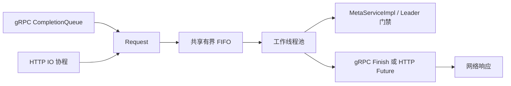

# MetaService Reactor 请求分发

全部 13 个 MetaService unary RPC 及对应 HTTP 接口共享 `ServiceRequestExecutor`。
Admin、Debug、健康检查和 Optimizer stream 保持原执行路径。



gRPC 使用 AsyncService，多个 poller 共享一个 CQ，避免接收注册在不同 pollset 间迁移；HTTP 先检查队列是否满/关闭，队满时直接返回
SERVICE_BUSY，避免在 IO 线程解析最终会被拒绝的大 JSON。检查通过后仍由 TrySubmit
原子决定入队，前置检查不预留槽位。非过载请求在 IO 解析 JSON 后挂起协程，Future 完成后回到原 IO executor 组装响应。
过载响应使用服务端生成的 request_id；未解析的非法 JSON 同样优先返回过载状态。
非拒绝请求由接入线程建立 RequestContext，捕获到达时间和客户端 IP；collector 查找、日志准备和业务执行均在 worker。
多 worker 共享 FIFO，完成顺序不保证与到达顺序相同。

启动时每个 gRPC 方法为每个 CQ poller 预挂一个接收请求，受理后补回该槽。
protobuf 解码发生在接收 tag 返回前；多个接收槽避免一个慢解码串行阻塞同方法的所有请求。
受理锁仅保护门禁和 CallLease 建立，RequestX 在锁外调用，避免 gRPC 内部等待串行阻塞所有 poller。
尚未完成注册的 Call 已计入存活调用，停机会等待其注册及完成事件排空。
gRPC 在创建 RequestContext 前检查队满/关闭，先返回拒绝响应，再补接收槽，避免 RequestX 等待拖慢拒绝。
前置检查不预留槽位，非拒绝请求仍由 TrySubmit 原子决定入队；拒绝计数每请求只记一次。
固定 gRPC 版本的接收匹配先取已有 pending RPC，再发布空闲接收槽，避免新请求持续越过旧请求。
pending RPC 位于框架受理层，尚未进入有界业务队列。取消的 pending 调用会被清理，关闭时仍排空接收槽。
固定版本的 HTTP/2 写准备回调进入原 transport combiner 的普通 FIFO，而不等待 finally 队列排空。
这样持续到来的读/取消回调不能一直推迟已准备好的响应；后续写批次仍在本次写清理后排队执行。
沿用原写状态机和串行保护，不增加线程、调度器或业务队列。
解析新请求的相对 timeout 时刷新 ExecCtx 时间缓存，避免持续 transport 回调后用旧时间计算绝对 deadline，
使尚未到期的请求提前失败。已经到期的请求仍按原规则跳过业务。

Request 持有执行与停机丢弃回调，接受后恰好执行其一。线程池通过显式Init启动，参数错误、重复初始化或线程创建失败返回false；无效回调返回kInvalid。协议adapter负责把业务异常转为错误响应，回调不得向线程池抛异常。接收槽补注册不再提供内存不足重试；不可恢复的分配或transport异常不会被吞掉并假装请求已经完成。
CompletionToken 使停机排空覆盖 HTTP 协程恢复、响应序列化和 socket 写入；响应写入超时为 30 秒。外层协程保留 protobuf 与 ReportEvent Arena。
gRPC Call 持有请求、响应、ServerContext 和 writer，最后 Finish CQ 事件释放后才能销毁。

## 配置

| 配置 | 默认 | 含义 |
|---|---|---|
| `kvcm.service.worker_thread_num` | `0` | 正数指定 worker 数；0 沿用正数 `grpc_max_threads`，否则取 `max(2, hardware_concurrency())` |
| `kvcm.service.worker_queue_capacity` | `2048` | 等待请求上限，不含运行中请求；显式 0 不限制 |
| `kvcm.service.grpc_cq_thread_num` | `2` | CQ poller 数，必须为正数 |
| `kvcm.service.worker_shutdown_mode` | `discard_pending` | 也支持 drain |

支持配置文件、`-e key=value` 和将点替换为下划线的环境变量，重启生效。
队列满时不等待空位、不执行业务，返回 SERVICE_BUSY；队列关闭或停机丢弃返回 SERVICE_NOT_READY。
gRPC transport 仍为 OK；C++/Python SDK 将队满映射为 ER_SERVICE_BUSY，不自动重试。
队列容量限制请求数。HTTP ReportEvent 另设 64 MiB 在途请求体预算，覆盖解析、排队和响应发送；预算耗尽返回 SERVICE_BUSY，也计入 rejected。该预算按原始 body 计量，不是进程 RSS 上限，也不限制其他请求。

当前版本接受 HTTP 全量快照的大小限制。单个请求超过 64 MiB 时，空载也会返回 SERVICE_BUSY，原样重试仍会被拒绝。全量快照低频上报，且协议要求一次提交完整快照。
grpc_max_threads 继续限制同步 Admin/Debug 和 Optimizer；正数也作为未显式配置 Meta worker 时的默认值，不限制 Meta CQ。
异步 Meta 的队列反压不同于原同步线程耗尽时的 RESOURCE_EXHAUSTED。

## 指标

每个 metrics.report_interval_ms 周期先原子获取工作池快照，再调用 reporter；停机在周期线程退出后上报最终快照。
以下指标进入 MetricsRegistry，支持 Logging、Prometheus 和 KMonitor。

| 指标 | 口径 |
|---|---|
| `service.request_queue_capacity` | 配置容量，0 为显式无界 |
| `service.request_queue_length` | 快照时等待请求数 |
| `service.request_queue_length_max` | 上次采样到本次采样的峰值 |
| `service.request_queue_length_avg` | 同窗口时间加权平均，队列每次变化累积面积后除以窗口时长 |
| `service.request_running` | 已领取尚未完成数 |
| `service.request_wait_time_us_max` / `avg` | 本窗口领取请求的最大/算术平均排队耗时，微秒，成功入队到领取 |
| `service.request_execution_time_us_max` / `avg` | 本窗口完成请求的最大/算术平均执行耗时，微秒，包含异常及回调收尾，不含排队及网络发送 |
| `service.request_completed` | 累计完成回调数，包括业务错误/异常及出队后跳过的过期 gRPC，不含拒绝/丢弃；不是业务成功数 |
| `service.request_rejected` | 满队列/关闭造成的累计拒绝数，包含 HTTP 解析前快速拒绝，每次请求只计一次 |
| `service.request_discarded` | 停机丢弃累计数 |
| `service.request_queue_wait_seconds` | 启动以来累计等待 histogram，Prometheus 导出秒，registry 的 _sum 保存整数微秒 |

无相关样本的窗口 MAX/AVG 为 0；跨窗口执行在完成窗口统计。
拒绝和未执行即丢弃不计入等待/执行统计。累计 histogram 和计数器不随窗口重置。
这些指标描述本进程采样窗口，不是全服务聚合值或端到端 RPC 耗时。
网络接收、gRPC 接收匹配及 protobuf 解码发生在入队前，须结合客户端总耗时和传输错误检查。

Logging 额外输出独立摘要行，避免全量 registry 因大量实例而被 logger 截断：

```bash
rg 'Report_Request_Executor_Metrics_By_Print' logs/metrics.log
```

## 生命周期

信号处理只写 lock-free 通知，由 CommandLine 主线程执行阻塞停机，避免 worker/网络线程 join 自己。
先停止 LeaderElector、关闭 Leader-only 门禁，再关闭队列。
discard_pending 在锁外回调尚未领取的请求并返回 SERVICE_NOT_READY；drain 继续领取。
两者保留 worker、CQ、HTTP IO，等待已接受请求完成业务及协议交接后再关闭。
Leader 门禁在真正执行 ServiceImpl 时检查，降级后排队请求通常返回 SERVER_NOT_LEADER。
gRPC 接收时已过期的请求直接返回 DEADLINE_EXCEEDED，不占工作队列；worker 开始处理时再次检查 deadline，不启动已过期请求的业务。
gRPC worker 开始业务前也检查 CQ 已观察到的取消。执行中的业务不会被中断；HTTP 客户端断开没有新增撤销协议。

Worker 维护排空计数；异常只在协议边界转换，gRPC返回UNKNOWN，HTTP以failed结果返回原IO协程并设置HTTP 500，不再重新抛出异常。
接收槽补注册和Finish不重试不可恢复的分配/transport异常，避免丢失接收槽后继续运行或重复提交完成操作。

## 验证入口

- ServiceRequestExecutorTest：FIFO、默认 2048、容量、并发、窗口统计、异常及停机。
- MetaServiceGRpcDispatchTest：真实 socket、1/2/3/4/5 poller、满队列快速拒绝、持续 transport 回调下 BUSY 回包、陈旧时钟下的相对期限、取消/超时、门禁及停机。
- CoroHttpDispatchTest：单 IO 线程推进、恢复 IO、Arena/缓存 JSON 生命周期。
- ServerMetricsTest：窗口上报、空闲归零、累计计数、最终快照。
- LoggingMetricsReporterTest / KmonitorMetricsReporterTest：指标进入实际 reporter。
- //integration_test/service_dispatch:service_dispatch_smoke：独立真实进程、HTTP/gRPC、Logging、混合并发及停机。
- //integration_test/meta_service:all：原有功能回归。

复用 feat/meta-service-request-dispatch 的异步接入及生命周期实现，适配 release/kvcm_v9_fix_1112，
新增默认容量、窗口 MAX/AVG、独立 Logging 摘要及测试。实测范围和限制见
[2026-11-10 验证记录](../develop/reactor_validation_20261110.md)。

固定 gRPC 版本在首个端口绑定失败时跳过 Shutdown，导致 default quota resource user 未释放。
内外源均应用小补丁，在此失败路径调用 Shutdown；进程冲突场景也使用默认自定义 quota，
不关闭 ASAN/LSAN。内源 HF3FS Allocator 现场测试需要专用远端与挂载，不属于本次接入层验证。
